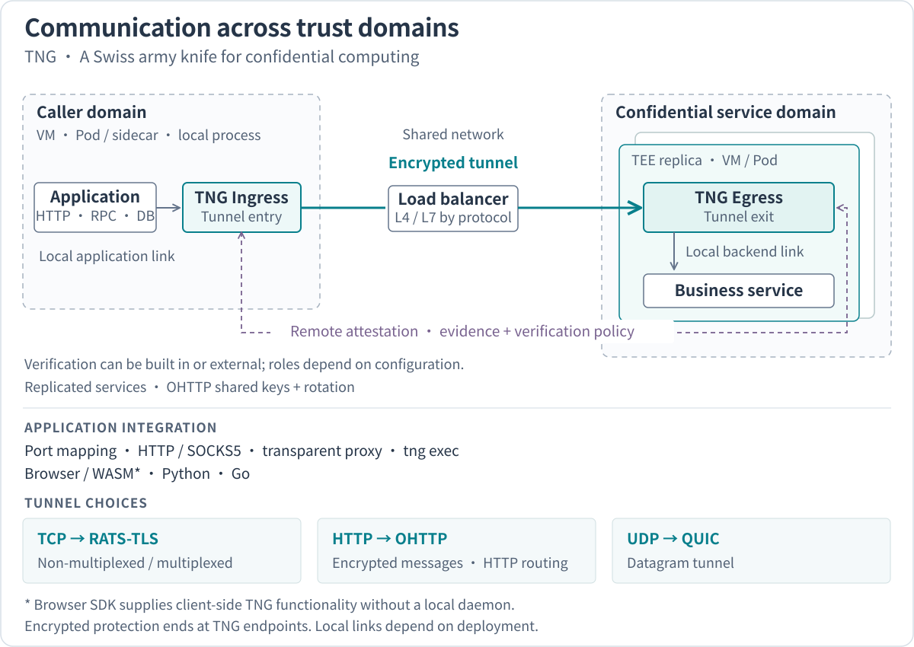

<div align="center">

# TNG

**Trusted Network Gateway**

Attested, encrypted communication across trust domains.

[Quick start](#quick-start) · [Documentation](docs/README.md) · [Scenarios](docs/scenarios/README.md) · [SDKs](#integrate-your-way) · [Benchmarks](docs/performance.md)

[](https://github.com/inclavare-containers/TNG/releases)
[](https://github.com/inclavare-containers/TNG/actions/workflows/test.yml)
[](LICENSE)

English · [简体中文](README_zh.md)

</div>

TNG is a Swiss army knife for communication in confidential computing. Connect existing applications to services in trusted execution environments (TEEs), verify the peer against your attestation policy, and encrypt traffic between TNG endpoints. Choose transparent interception, a local proxy, or an SDK to fit your application.



*TNG protects the link between tunnel endpoints. Local application links and attestation roles depend on deployment. The browser SDK supplies client-side TNG functionality without a local daemon. [Figure notes and capability references](docs/assets/README.md).*

## Quick start

Run an HTTP request through a local **RATS-TLS tunnel, non-multiplexed**, using the complete [example configuration](examples/quickstart/local.json). This demo disables remote attestation on both endpoints with `no_ra: true`: it demonstrates encrypted forwarding, without verifying a TEE or authenticating a trusted workload. Use it on your own machine only.

Install a prebuilt `tng` binary from [Releases](https://github.com/inclavare-containers/TNG/releases) and put it on your `PATH`. You also need Git, Python 3 and curl. No root access, TEE or Docker is needed for this port-mapping example. Keep ports 38080, 38081 and 38082 free.

Get the example:

```sh
git clone https://github.com/inclavare-containers/TNG.git
cd TNG
```

In terminal 1, start a loopback-only backend:

```sh
cd examples/quickstart/backend
python3 -m http.server 38080 --bind 127.0.0.1
```

In terminal 2, from the same repository directory, start both tunnel endpoints:

```sh
tng launch --config-file examples/quickstart/local.json
```

In terminal 3, send a request through the tunnel:

```sh
curl --fail --noproxy '*' http://127.0.0.1:38082/hello.txt
# Hello through TNG.
```

Stop TNG and the backend with Ctrl+C in their terminals. [Follow the full tutorial](docs/getting-started.md) for the topology, troubleshooting and the next step: enabling real remote attestation.

## From an application to a confidential service

| Your task | TNG capability | Start here |
| --- | --- | --- |
| Connect an existing application | Port mapping, HTTP/SOCKS5 proxy, transparent interception, or `tng exec` | [Choose an integration](docs/README.md#choose-an-integration) |
| Protect TCP or UDP traffic | RATS-TLS for TCP; QUIC datagram tunnels for UDP | [Configuration reference](docs/configuration.md) |
| Keep HTTP routing infrastructure | OHTTP encrypts messages while retaining an outer HTTP envelope for L7 routing | [OHTTP cluster](docs/scenarios/03-business-cluster/README.md) |
| Deploy replicated confidential services | Protocol-specific L4/L7 load balancing; shared and rotating OHTTP keys | [Load balancing](docs/using-with-slb.md) · [Key sharing](docs/peer_shared.md) |
| Verify one or both peers | Unilateral, mutual or reverse attestation, with configurable verification policies | [Remote attestation](docs/remote_attestation.md) |
| Protect AI inference requests | vLLM topologies, browser and OpenAI client integrations | [Inference scenarios](docs/scenarios/README.md) |

Select [RATS-TLS or OHTTP](docs/protocols.md) for your traffic and deployment. RATS-TLS has separate non-multiplexed and multiplexed configurations. UDP tunneling uses QUIC datagrams and requires the corresponding features in your binary. Transparent interception and `tng exec` have platform and permission requirements described in their guides.

## Integrate your way

| Interface | Installation or entry point | Guide |
| --- | --- | --- |
| CLI / daemon | [Binary and RPM releases](https://github.com/inclavare-containers/TNG/releases) | [Getting started](docs/getting-started.md) |
| Container | `ghcr.io/inclavare-containers/tng` | [Build and deployment](docs/developer.md#build-and-deployment) |
| Existing process | `tng exec --config-file config.json -- ./your-app` | [Process interception](tng-hook/README.md) |
| Browser / JavaScript | `npm install @inclavare-containers/tng` | [WASM SDK](tng-wasm/README.md) · [Live demo](https://inclavare-containers.github.io/TNG/) |
| Python | `pip install tng-sdk` | [Python SDK](tng-python/README.md) |
| Go | `go get github.com/inclavare-containers/tng/tng-go` | [Go SDK](tng-go/README.md) |

The `tng exec` command above illustrates the interface; use the hook guide for its configuration. Python and Go integration requirements are described in their SDK guides. Browser integration runs through WebAssembly.

## Performance

The [performance snapshot](docs/performance.md) reports TCP throughput, HTTP keep-alive and HTTP without keep-alive, including CPU and memory measurements. It distinguishes RATS-TLS non-multiplexed, RATS-TLS multiplexed and OHTTP from the reference proxies.

The recorded snapshot uses TNG 2.11.0 at revision `6460428f` on two 4-vCPU Alibaba Cloud ECS hosts, with remote attestation enabled. Results are single-run measurements with the strongest measured round selected per workload/concurrency cell. See the report for hardware, policies and complete results; use the [benchmark harness](bench/README.md) to measure your deployment.

## Documentation and contributing

[Documentation home](docs/README.md) · [Scenario catalog](docs/scenarios/README.md) · [Configuration](docs/configuration.md) · [Compatibility](docs/version_compatibility.md) · [Changelog](CHANGELOG.md)

TNG integrates with the Confidential Containers [guest-components](https://github.com/confidential-containers/guest-components) and [Trustee](https://github.com/confidential-containers/trustee) ecosystem. The [architecture guide](docs/architecture.md) introduces tunnel endpoints and attestation roles; the [developer guide](docs/developer.md) covers builds and tests.

Contributions are welcome through [issues](https://github.com/inclavare-containers/TNG/issues) and [pull requests](https://github.com/inclavare-containers/TNG/pulls). Follow the developer guide before running the test suite; integration tests share network state and must run sequentially.

```sh
make clippy
cargo fmt --check
cargo build
```

Licensed under [Apache-2.0](LICENSE).
