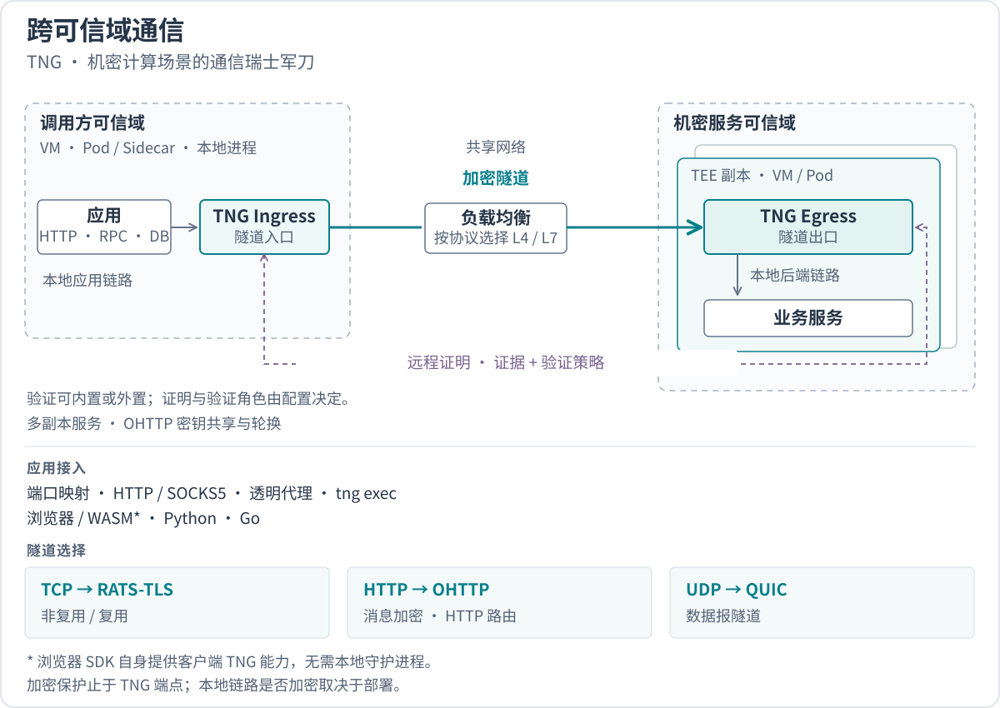

<div align="center">

# TNG

**Trusted Network Gateway · 可信网络网关**

面向机密计算的跨可信域远程证明与加密通信工具。

[快速开始](#快速开始) · [文档](docs/README_zh.md) · [场景](docs/scenarios/README_zh.md) · [SDK](#选择接入方式) · [性能](docs/performance_zh.md)

[](https://github.com/inclavare-containers/TNG/releases)
[](https://github.com/inclavare-containers/TNG/actions/workflows/test.yml)
[](LICENSE)

[English](README.md) · 简体中文

</div>

TNG 是机密计算场景中跨可信域通信的瑞士军刀。将现有应用连接到可信执行环境（TEE）中的服务，按远程证明策略验证对端，并加密 TNG 端点之间的流量。你可以根据应用选择透明拦截、本地代理或 SDK 接入。



*TNG 保护隧道端点之间的链路。本地应用链路和证明角色取决于部署方式。浏览器 SDK 提供客户端 TNG 能力，无需本地守护进程。[图示说明与能力依据](docs/assets/README_zh.md)。*

## 快速开始

使用完整的[示例配置](examples/quickstart/local.json)，通过本地 **RATS-TLS 非复用隧道**发送一个 HTTP 请求。演示在两端设置 `no_ra: true`，关闭远程证明：它演示加密转发，不验证 TEE，也不认证可信工作负载。仅在你自己的机器上体验。

从 [Releases](https://github.com/inclavare-containers/TNG/releases) 安装预编译 `tng` 二进制并加入 `PATH`。还需要 Git、Python 3 和 curl。这个端口映射示例无需 root 权限、TEE 或 Docker。请确保 38080、38081、38082 端口空闲。

获取示例：

```sh
git clone https://github.com/inclavare-containers/TNG.git
cd TNG
```

在终端 1 启动仅监听本机的后端：

```sh
cd examples/quickstart/backend
python3 -m http.server 38080 --bind 127.0.0.1
```

在终端 2 的同一仓库目录下启动两个隧道端点：

```sh
tng launch --config-file examples/quickstart/local.json
```

在终端 3 通过隧道发送请求：

```sh
curl --fail --noproxy '*' http://127.0.0.1:38082/hello.txt
# Hello through TNG.
```

在对应终端按 Ctrl+C 停止 TNG 和后端。[完整入门教程](docs/getting-started_zh.md)说明拓扑、故障排查，以及下一步如何启用真实远程证明。

## 从应用到机密服务

| 你的任务 | TNG 能力 | 从这里开始 |
| --- | --- | --- |
| 接入现有应用 | 端口映射、HTTP/SOCKS5 代理、透明拦截或 `tng exec` | [选择接入方式](docs/README_zh.md#选择接入方式) |
| 保护 TCP 或 UDP 流量 | TCP 使用 RATS-TLS；UDP 使用 QUIC 数据报隧道 | [配置参考](docs/configuration_zh.md) |
| 继续使用 HTTP 路由设施 | OHTTP 加密消息，保留外层 HTTP 封装用于 L7 路由 | [OHTTP 集群](docs/scenarios/03-business-cluster/README_zh.md) |
| 部署多副本机密服务 | 按协议选择 L4/L7 负载均衡；共享和轮换 OHTTP 密钥 | [负载均衡](docs/using-with-slb_zh.md) · [密钥共享](docs/peer_shared_zh.md) |
| 验证单方或双方 | 单向、双向或反向证明，可配置验证策略 | [远程证明](docs/remote_attestation_zh.md) |
| 保护 AI 推理请求 | vLLM 拓扑、浏览器和 OpenAI 客户端接入 | [推理场景](docs/scenarios/README_zh.md) |

根据流量和部署选择 [RATS-TLS 或 OHTTP](docs/protocols_zh.md)。RATS-TLS 分为非复用和复用两种配置。UDP 隧道使用 QUIC 数据报，二进制需启用对应功能。透明拦截和 `tng exec` 的平台与权限要求见各自指南。

## 选择接入方式

| 接口 | 安装方式或入口 | 指南 |
| --- | --- | --- |
| CLI / 守护进程 | [二进制与 RPM 发布包](https://github.com/inclavare-containers/TNG/releases) | [入门教程](docs/getting-started_zh.md) |
| 容器 | `ghcr.io/inclavare-containers/tng` | [构建与部署](docs/developer_zh.md#构建与部署) |
| 现有进程 | `tng exec --config-file config.json -- ./your-app` | [进程拦截](tng-hook/README_zh.md) |
| 浏览器 / JavaScript | `npm install @inclavare-containers/tng` | [WASM SDK](tng-wasm/README_zh.md) · [在线演示](https://inclavare-containers.github.io/TNG/) |
| Python | `pip install tng-sdk` | [Python SDK](tng-python/README_zh.md) |
| Go | `go get github.com/inclavare-containers/tng/tng-go` | [Go SDK](tng-go/README_zh.md) |

上面的 `tng exec` 命令用于说明接口，完整配置见 hook 指南。Python 和 Go 的接入依赖见各 SDK 文档。浏览器通过 WebAssembly 运行。

## 性能

[性能快照](docs/performance_zh.md)提供 TCP 吞吐、HTTP 长连接和无长连接场景下的结果，包括 CPU 与内存测量，并分别列出 RATS-TLS 非复用、RATS-TLS 复用、OHTTP 与参考代理的数据。

已记录的快照使用 TNG 2.11.0、revision `6460428f`，在两台 4 vCPU 阿里云 ECS 上启用远程证明测量。结果来自单次测量，每个负载与并发组合选取所测轮次中表现最强的一轮。硬件、策略和完整数据见报告；使用 [benchmark 工具](bench/README_zh.md)测量你的部署。

## 文档与贡献

[文档首页](docs/README_zh.md) · [场景目录](docs/scenarios/README_zh.md) · [配置](docs/configuration_zh.md) · [兼容性](docs/version_compatibility_zh.md) · [变更日志](CHANGELOG.md)

TNG 与 Confidential Containers 的 [guest-components](https://github.com/confidential-containers/guest-components) 和 [Trustee](https://github.com/confidential-containers/trustee) 生态配合使用。[架构指南](docs/architecture_zh.md)介绍隧道端点与证明角色；[开发者指南](docs/developer_zh.md)说明构建和测试方法。

欢迎通过 [Issue](https://github.com/inclavare-containers/TNG/issues) 和 [Pull Request](https://github.com/inclavare-containers/TNG/pulls) 参与贡献。运行测试前先阅读开发者指南；集成测试共享网络状态，必须顺序运行。

```sh
make clippy
cargo fmt --check
cargo build
```

采用 [Apache-2.0](LICENSE) 许可证。
