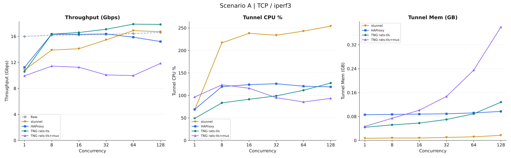
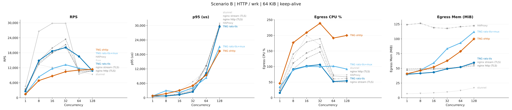
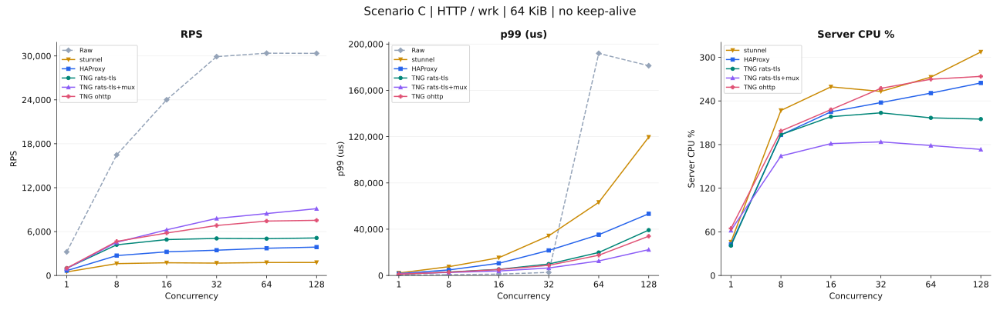

# TNG 性能快照

> 本页记录当前 TNG 版本的跟踪式性能快照，每次性能变更合入后重新生成。页面展示单次运行的数据，不做前后对比。

## 本页是什么

本页在标准双主机压测方法下跟踪当前开发版本的实测性能：三个场景（iperf3 TCP 吞吐、HTTP keep-alive、HTTP 无 keep-alive），每个场景一张表，一行一个 workload、一列一个指标，并为每个场景配一张图。页面始终描述当前版本：性能变更合入时，其 PR 会用新的最终实测结果重新生成本页（见[更新规则](#更新规则)一节）。单个变更的前后对比证据保留在各 PR 的压测报告里，不放在本页。

页面上的每个数字都来自同一次实测。场景表格与页末逐字嵌入的完整报告，以当前生成器的格式呈现该次运行的实测数值，图表由 `bench/gen-svg.py` 渲染同一组数值，因此快照可追溯，不存在手抄数字。

## 如何运行压测

压测工具说明在 [`bench/README.md`](../bench/README.md)：server/backend 主机执行 `bash bench/server.sh`，client/load 主机执行 `bash bench/client.sh <SERVER_IP>`，运行产出三个留存的 JSON 文件。[`bench/reporting.md`](../bench/reporting.md) 记录报告生成（`bench/gen-report.sh`，单次或 `--compare` 模式）、SVG 图生成（`bench/gen-svg.py`）与构建身份记录器。压测运行必须串行：驱动程序启动前必须持有两台共享主机的独占 bench 锁，避免并发运行在同一批测试点上叠加负载。本页不重复上述文档内容。

## 测量模式

当前快照按 `master` 上的现行方法测量：

- 开启远程证明：egress 通过 attestation-agent Unix socket 提交证明，ingress 使用内置证明服务按 `hardware_only` 策略验证。
- HTTP 响应体 64 KiB。每轮运行同时测量两种 HTTP 连接模式（keep-alive 与无 keep-alive）以及 iperf3 TCP 吞吐。
- 每个场景的并发梯度为 1、8、16、32、64、128。
- 每个 workload/并发测试点都在全新启动的隧道/代理进程上测量，因此测试点的内存峰值就是该点自身开销，而不是早期测试点遗留的分配器高水位。
- 每个测试点取最强一轮（多轮中请求率或吞吐最高的一轮）。
- CPU 100% 等于一个逻辑核。下文表格中的 Egress 指被测网关/代理的服务端实例（TNG egress；HAProxy 主进程加工作进程；stunnel 服务端容器），Ingress 指其客户端实例（TNG ingress）。场景 A 采样入口实例；场景 B、C 采样出口实例。`raw` 参考没有代理进程，其资源列天然缺失。

## 实测快照

实测二进制：tng 2.11.0，ingress 与 egress 均构建自源码版本 `6460428f`。

TNG 提供三种不同的隧道配置，不同模式的数值相差数倍，因此下文每个标签都明确指明配置：

| 标签 | 配置 |
| --- | --- |
| `raw` | 直连，不经任何 TLS 代理（参考） |
| `stunnel` | stunnel TLS 隧道（参考） |
| `haproxy` | HAProxy TLS 终结代理（参考） |
| `nginx stream (TLS)` | nginx stream 模块 L4 TLS 代理（参考） |
| `nginx http (TLS)` | nginx http 模块 L7 TLS 反向代理，对后端使用 HTTP/1.1 keep-alive（参考） |
| `rats-tls` | TNG rats-tls 非多路复用：每条客户端 TCP 连接对应一条到 egress 的 TLS 连接 |
| `rats-tls+mux` | TNG rats-tls 多路复用：多条客户端连接共享一条到 egress 的 HTTP/2 CONNECT 隧道 |
| `ohttp` | TNG ohttp：Oblivious HTTP（RFC 9458）密封请求/响应信封，ingress 通过明文 HTTP POST 到 egress |

### 场景 A - TCP / iperf3 吞吐

每个非 raw 单元格括号内是相对同一并发度下 `raw` 基线的百分比变化。场景 A 未测量 ohttp 与 `nginx http (TLS)`：nginx http 模块是 L7 反向代理，raw TCP 的 iperf3 流量没有 L7 形态。

| Streams | Workload | Throughput (Gbps) | Ingress CPU % | Ingress Mem (GB) |
| --- | --- | --- | --- | --- |
| 1 | raw | 15.90 | - | - |
| 1 | stunnel | 10.96 (-31%) | 77.5 | 0.007 |
| 1 | haproxy | 11.18 (-30%) | 71.5 | 0.086 |
| 1 | nginx stream (TLS) | 11.39 (-28%) | 78.0 | 0.045 |
| 1 | rats-tls | 12.45 (-22%) | 54.0 | 0.046 |
| 1 | rats-tls+mux | 9.80 (-38%) | 91.0 | 0.051 |
| 8 | raw | 16.19 | - | - |
| 8 | stunnel | 14.05 (-13%) | 222.5 | 0.008 |
| 8 | haproxy | 16.28 (+1%) | 119.0 | 0.087 |
| 8 | nginx stream (TLS) | 16.33 (+1%) | 98.5 | 0.046 |
| 8 | rats-tls | 16.36 (+1%) | 82.5 | 0.053 |
| 8 | rats-tls+mux | 11.88 (-27%) | 127.0 | 0.070 |
| 16 | raw | 16.22 | - | - |
| 16 | stunnel | 14.22 (-12%) | 236.5 | 0.008 |
| 16 | haproxy | 16.46 (+1%) | 117.4 | 0.088 |
| 16 | nginx stream (TLS) | 16.59 (+2%) | 117.5 | 0.047 |
| 16 | rats-tls | 16.61 (+2%) | 90.5 | 0.059 |
| 16 | rats-tls+mux | 11.07 (-32%) | 124.4 | 0.102 |
| 32 | raw | 16.30 | - | - |
| 32 | stunnel | 15.45 (-5%) | 233.5 | 0.010 |
| 32 | haproxy | 15.97 (-2%) | 120.0 | 0.089 |
| 32 | nginx stream (TLS) | 17.11 (+5%) | 117.0 | 0.048 |
| 32 | rats-tls | 17.09 (+5%) | 98.5 | 0.069 |
| 32 | rats-tls+mux | 9.90 (-39%) | 91.5 | 0.148 |
| 64 | raw | 16.46 | - | - |
| 64 | stunnel | 16.79 (+2%) | 245.7 | 0.012 |
| 64 | haproxy | 15.68 (-5%) | 118.0 | 0.091 |
| 64 | nginx stream (TLS) | 17.82 (+8%) | 124.0 | 0.051 |
| 64 | rats-tls | 17.86 (+9%) | 111.5 | 0.089 |
| 64 | rats-tls+mux | 9.95 (-40%) | 90.5 | 0.235 |
| 128 | raw | 16.61 | - | - |
| 128 | stunnel | 16.71 (+1%) | 250.8 | 0.017 |
| 128 | haproxy | 14.66 (-12%) | 114.0 | 0.097 |
| 128 | nginx stream (TLS) | 17.72 (+7%) | 131.5 | 0.058 |
| 128 | rats-tls | 17.97 (+8%) | 128.5 | 0.128 |
| 128 | rats-tls+mux | 11.75 (-29%) | 97.0 | 0.389 |

### 场景 B - HTTP / wrk，64 KiB 响应体，keep-alive

wrk 为每个客户端维持一条持久 TCP+TLS 连接，证明开销被复用该连接的请求摊薄。

| Conns | Workload | Throughput (Gbps) | RPS | Mean (us) | p50 (us) | p90 (us) | p95 (us) | p99 (us) | Success % | Ingress CPU % | Egress CPU % | Egress Mem (MiB) |
| --- | --- | --- | --- | --- | --- | --- | --- | --- | --- | --- | --- | --- |
| 1 | raw | 2.36 | 4710 | 218 | 200 | 258 | 373 | 650 | 100.0 | - | - | - |
| 1 | stunnel | 1.62 (-31%) | 3230 (-31%) | 316 (+45%) | 301 (+50%) | 354 (+37%) | 375 (+1%) | 646 (-1%) | 100.0 (+0%) | - | 24.3 | 6.9 |
| 1 | haproxy | 1.73 (-27%) | 3456 (-27%) | 291 (+33%) | 282 (+41%) | 332 (+29%) | 350 (-6%) | 405 (-38%) | 100.0 (+0%) | - | 23.0 | 115.5 |
| 1 | nginx stream (TLS) | 1.67 (-29%) | 3325 (-29%) | 305 (+40%) | 293 (+46%) | 342 (+33%) | 363 (-3%) | 577 (-11%) | 100.0 (+0%) | - | 22.7 | 46.6 |
| 1 | nginx http (TLS) | 1.52 (-36%) | 3035 (-36%) | 336 (+54%) | 322 (+61%) | 371 (+44%) | 391 (+5%) | 493 (-24%) | 100.0 (+0%) | - | 30.3 | 49.0 |
| 1 | rats-tls | 1.33 (-44%) | 2659 (-44%) | 433 (+99%) | 359 (+80%) | 424 (+64%) | 512 (+37%) | 1030 (+58%) | 100.0 (+0%) | - | 15.7 | 46.7 |
| 1 | rats-tls+mux | 0.76 (-68%) | 1523 (-68%) | 701 (+222%) | 643 (+222%) | 719 (+179%) | 747 (+100%) | 3020 (+365%) | 100.0 (+0%) | - | 34.7 | 46.4 |
| 1 | ohttp | 0.64 (-73%) | 1267 (-73%) | 787 (+261%) | 782 (+291%) | 860 (+233%) | 882 (+136%) | 950 (+46%) | 100.0 (+0%) | - | 51.5 | 47.3 |
| 8 | raw | 13.04 | 26650 | 756 | 258 | 454 | 1312 | 17950 | 100.0 | - | - | - |
| 8 | stunnel | 6.63 (-49%) | 13198 (-50%) | 639 (-15%) | 563 (+118%) | 843 (+86%) | 974 (-26%) | 2600 (-86%) | 100.0 (+0%) | - | 124.0 | 7.5 |
| 8 | haproxy | 6.87 (-47%) | 13677 (-49%) | 579 (-23%) | 533 (+107%) | 790 (+74%) | 909 (-31%) | 1530 (-91%) | 100.0 (+0%) | - | 110.3 | 116.6 |
| 8 | nginx stream (TLS) | 7.12 (-45%) | 14570 (-45%) | 552 (-27%) | 513 (+99%) | 726 (+60%) | 820 (-38%) | 1340 (-93%) | 100.0 (+0%) | - | 85.7 | 47.1 |
| 8 | nginx http (TLS) | 6.64 (-49%) | 13230 (-50%) | 598 (-21%) | 564 (+119%) | 793 (+75%) | 885 (-33%) | 1230 (-93%) | 100.0 (+0%) | - | 135.3 | 49.5 |
| 8 | rats-tls | 7.28 (-44%) | 14795 (-44%) | 537 (-29%) | 527 (+104%) | 674 (+48%) | 726 (-45%) | 860 (-95%) | 100.0 (+0%) | - | 89.3 | 48.8 |
| 8 | rats-tls+mux | 4.12 (-68%) | 8211 (-69%) | 1330 (+76%) | 890 (+245%) | 1240 (+173%) | 2419 (+84%) | 14920 (-17%) | 100.0 (+0%) | - | 88.0 | 51.2 |
| 8 | ohttp | 3.07 (-76%) | 6114 (-77%) | 1290 (+71%) | 1260 (+388%) | 1650 (+263%) | 1752 (+34%) | 2009 (-89%) | 100.0 (+0%) | - | 170.0 | 56.2 |
| 16 | raw | 14.96 | 30571 | 23260 | 331 | 113270 | 160439 | 198200 | 100.0 | - | - | - |
| 16 | stunnel | 6.88 (-54%) | 14091 (-54%) | 1210 (-95%) | 980 (+196%) | 2000 (-98%) | 2608 (-98%) | 4720 (-98%) | 100.0 (+0%) | - | 174.3 | 8.4 |
| 16 | haproxy | 8.64 (-42%) | 17679 (-42%) | 910 (-96%) | 803 (+143%) | 1380 (-99%) | 1716 (-99%) | 3100 (-98%) | 100.0 (+0%) | - | 143.3 | 116.6 |
| 16 | nginx stream (TLS) | 9.44 (-37%) | 19226 (-37%) | 825 (-96%) | 748 (+126%) | 1220 (-99%) | 1417 (-99%) | 2220 (-99%) | 100.0 (+0%) | - | 125.3 | 48.0 |
| 16 | nginx http (TLS) | 8.80 (-41%) | 17899 (-41%) | 900 (-96%) | 819 (+147%) | 1290 (-99%) | 1503 (-99%) | 2230 (-99%) | 100.0 (+0%) | - | 163.7 | 49.7 |
| 16 | rats-tls | 9.04 (-40%) | 18435 (-40%) | 860 (-96%) | 828 (+150%) | 1170 (-99%) | 1273 (-99%) | 1590 (-99%) | 100.0 (+0%) | - | 100.3 | 49.6 |
| 16 | rats-tls+mux | 5.94 (-60%) | 11825 (-61%) | 1360 (-94%) | 1290 (+290%) | 1750 (-98%) | 1957 (-99%) | 3440 (-98%) | 100.0 (+0%) | - | 103.3 | 56.2 |
| 16 | ohttp | 3.99 (-73%) | 7953 (-74%) | 2009 (-91%) | 1870 (+465%) | 2920 (-97%) | 3210 (-98%) | 3900 (-98%) | 100.0 (+0%) | - | 206.3 | 63.6 |
| 32 | raw | 14.96 | 30554 | 28960 | 666 | 131460 | 169551 | 200090 | 100.0 | - | - | - |
| 32 | stunnel | 5.03 (-66%) | 10025 (-67%) | 3390 (-88%) | 2930 (+340%) | 5510 (-96%) | 6522 (-96%) | 10310 (-95%) | 100.0 (+0%) | - | 187.7 | 9.7 |
| 32 | haproxy | 9.84 (-34%) | 20056 (-34%) | 1770 (-94%) | 1280 (+92%) | 3270 (-98%) | 4618 (-97%) | 8700 (-96%) | 100.0 (+0%) | - | 161.3 | 117.1 |
| 32 | nginx stream (TLS) | 11.36 (-24%) | 23133 (-24%) | 1400 (-95%) | 1220 (+83%) | 2220 (-98%) | 2806 (-98%) | 4540 (-98%) | 100.0 (+0%) | - | 147.3 | 49.1 |
| 32 | nginx http (TLS) | 10.32 (-31%) | 21132 (-31%) | 1590 (-95%) | 1320 (+98%) | 2600 (-98%) | 3309 (-98%) | 5900 (-97%) | 100.0 (+0%) | - | 190.3 | 49.9 |
| 32 | rats-tls | 9.76 (-35%) | 19949 (-35%) | 1650 (-94%) | 1520 (+128%) | 2310 (-98%) | 2534 (-99%) | 4870 (-98%) | 100.0 (+0%) | - | 104.0 | 51.7 |
| 32 | rats-tls+mux | 6.94 (-54%) | 13818 (-55%) | 2630 (-91%) | 2220 (+233%) | 3260 (-98%) | 3765 (-98%) | 21090 (-89%) | 100.0 (+0%) | - | 103.7 | 72.9 |
| 32 | ohttp | 4.82 (-68%) | 9607 (-69%) | 3330 (-89%) | 3100 (+365%) | 4870 (-96%) | 5577 (-97%) | 6970 (-97%) | 100.0 (+0%) | - | 235.7 | 74.2 |
| 64 | raw | 14.96 | 30546 | 14410 | 1810 | 38580 | 124221 | 192640 | 100.0 | - | - | - |
| 64 | stunnel | 5.79 (-61%) | 11534 (-62%) | 6130 (-57%) | 5180 (+186%) | 9350 (-76%) | 11423 (-91%) | 29830 (-85%) | 100.0 (+0%) | - | 228.7 | 12.4 |
| 64 | haproxy | 10.72 (-28%) | 21879 (-28%) | 3430 (-76%) | 2260 (+25%) | 7370 (-81%) | 10113 (-92%) | 16070 (-92%) | 100.0 (+0%) | - | 174.3 | 118.9 |
| 64 | nginx stream (TLS) | 11.92 (-20%) | 24270 (-21%) | 2940 (-80%) | 2190 (+21%) | 5430 (-86%) | 7620 (-94%) | 14650 (-92%) | 100.0 (+0%) | - | 153.7 | 51.5 |
| 64 | nginx http (TLS) | 11.20 (-25%) | 22827 (-25%) | 2940 (-80%) | 2370 (+31%) | 5420 (-86%) | 6911 (-94%) | 10860 (-94%) | 100.0 (+0%) | - | 197.7 | 51.5 |
| 64 | rats-tls | 11.20 (-25%) | 22836 (-25%) | 2780 (-81%) | 2590 (+43%) | 4240 (-89%) | 4910 (-96%) | 7170 (-96%) | 100.0 (+0%) | - | 116.7 | 56.1 |
| 64 | rats-tls+mux | 6.96 (-53%) | 14152 (-54%) | 4460 (-69%) | 4380 (+142%) | 6470 (-83%) | 7109 (-94%) | 8560 (-96%) | 100.0 (+0%) | - | 100.3 | 61.7 |
| 64 | ohttp | 5.36 (-64%) | 10685 (-65%) | 6020 (-58%) | 5590 (+209%) | 8590 (-78%) | 9820 (-92%) | 13190 (-93%) | 100.0 (+0%) | - | 259.8 | 87.2 |
| 128 | raw | 15.04 | 30645 | 11950 | 3710 | 7130 | 79715 | 187440 | 100.0 | - | - | - |
| 128 | stunnel | 6.96 (-54%) | 14194 (-54%) | 10750 (-10%) | 8390 (+126%) | 17700 (+148%) | 23154 (-71%) | 81040 (-57%) | 100.0 (+0%) | - | 229.7 | 17.4 |
| 128 | haproxy | 11.20 (-26%) | 22806 (-26%) | 6510 (-46%) | 4100 (+11%) | 14790 (+107%) | 19163 (-76%) | 27670 (-85%) | 100.0 (+0%) | - | 180.7 | 122.6 |
| 128 | nginx stream (TLS) | 12.72 (-15%) | 25954 (-15%) | 5520 (-54%) | 3880 (+5%) | 11430 (+60%) | 15361 (-81%) | 24270 (-87%) | 100.0 (+0%) | - | 160.7 | 54.1 |
| 128 | nginx http (TLS) | 11.92 (-21%) | 24344 (-21%) | 5540 (-54%) | 4370 (+18%) | 10720 (+50%) | 13725 (-83%) | 20700 (-89%) | 100.0 (+0%) | - | 197.0 | 53.8 |
| 128 | rats-tls | 12.48 (-17%) | 25391 (-17%) | 5050 (-58%) | 4600 (+24%) | 7510 (+5%) | 8602 (-89%) | 13320 (-93%) | 100.0 (+0%) | - | 128.2 | 64.6 |
| 128 | rats-tls+mux | 7.20 (-52%) | 14644 (-52%) | 8600 (-28%) | 8400 (+126%) | 12470 (+75%) | 13891 (-83%) | 16500 (-91%) | 100.0 (+0%) | - | 101.3 | 68.4 |
| 128 | ohttp | 5.60 (-63%) | 11158 (-64%) | 11400 (-5%) | 10770 (+190%) | 15900 (+123%) | 17959 (-77%) | 22780 (-88%) | 100.0 (+0%) | - | 263.7 | 124.0 |

### 场景 C - HTTP / wrk，64 KiB 响应体，无 keep-alive

wrk 发送 `Connection: close`，每个请求都要支付新建 TCP 连接与完整 TLS 握手（对三种 TNG 配置还包括证明与验证）。

| Conns | Workload | Throughput (Gbps) | RPS | Mean (us) | p50 (us) | p90 (us) | p95 (us) | p99 (us) | Success % | Ingress CPU % | Egress CPU % | Egress Mem (MiB) |
| --- | --- | --- | --- | --- | --- | --- | --- | --- | --- | --- | --- | --- |
| 1 | raw | 1.61 | 3204 | 215 | 212 | 252 | 265 | 300 | 100.0 | - | - | - |
| 1 | stunnel | 0.24 (-85%) | 487 (-85%) | 1990 (+826%) | 1980 (+834%) | 2100 (+733%) | 2133 (+705%) | 2200 (+633%) | 100.0 (+0%) | - | 46.3 | 6.9 |
| 1 | haproxy | 0.33 (-80%) | 664 (-79%) | 1430 (+565%) | 1430 (+575%) | 1510 (+499%) | 1541 (+482%) | 1620 (+440%) | 100.0 (+0%) | - | 42.7 | 116.4 |
| 1 | nginx stream (TLS) | 0.32 (-80%) | 647 (-80%) | 1510 (+602%) | 1500 (+608%) | 1600 (+535%) | 1646 (+521%) | 1810 (+503%) | 100.0 (+0%) | - | 40.0 | 46.8 |
| 1 | nginx http (TLS) | 0.32 (-80%) | 634 (-80%) | 1540 (+616%) | 1530 (+622%) | 1650 (+555%) | 1688 (+537%) | 1780 (+493%) | 100.0 (+0%) | - | 38.7 | 48.9 |
| 1 | rats-tls | 0.50 (-69%) | 994 (-69%) | 970 (+351%) | 960 (+353%) | 1030 (+309%) | 1057 (+299%) | 1120 (+273%) | 100.0 (+0%) | - | 40.7 | 47.7 |
| 1 | rats-tls+mux | 0.47 (-71%) | 942 (-71%) | 1030 (+379%) | 1000 (+372%) | 1130 (+348%) | 1222 (+361%) | 1560 (+420%) | 100.0 (+0%) | - | 62.3 | 46.8 |
| 1 | ohttp | 0.50 (-69%) | 998 (-69%) | 970 (+351%) | 960 (+353%) | 1030 (+309%) | 1048 (+295%) | 1100 (+267%) | 100.0 (+0%) | - | 65.7 | 47.9 |
| 8 | raw | 8.00 | 16342 | 342 | 324 | 455 | 514 | 671 | 100.0 | - | - | - |
| 8 | stunnel | 0.80 (-90%) | 1600 (-90%) | 4940 (+1344%) | 4820 (+1388%) | 6220 (+1267%) | 6707 (+1205%) | 7740 (+1054%) | 100.0 (+0%) | - | 222.7 | 7.8 |
| 8 | haproxy | 1.36 (-83%) | 2715 (-83%) | 2890 (+745%) | 2790 (+761%) | 3750 (+724%) | 4079 (+694%) | 4830 (+620%) | 100.0 (+0%) | - | 191.0 | 117.8 |
| 8 | nginx stream (TLS) | 1.19 (-85%) | 2370 (-86%) | 3330 (+874%) | 3210 (+891%) | 4400 (+867%) | 4814 (+837%) | 5570 (+730%) | 100.0 (+0%) | - | 200.7 | 47.5 |
| 8 | nginx http (TLS) | 1.19 (-85%) | 2366 (-86%) | 3330 (+874%) | 3210 (+891%) | 4410 (+869%) | 4843 (+842%) | 5690 (+748%) | 100.0 (+0%) | - | 187.7 | 49.6 |
| 8 | rats-tls | 2.10 (-74%) | 4174 (-74%) | 1870 (+447%) | 1830 (+465%) | 2270 (+399%) | 2456 (+378%) | 3020 (+350%) | 100.0 (+0%) | - | 191.7 | 48.8 |
| 8 | rats-tls+mux | 2.22 (-72%) | 4430 (-73%) | 1720 (+403%) | 1700 (+425%) | 2110 (+364%) | 2237 (+335%) | 2490 (+271%) | 100.0 (+0%) | - | 162.7 | 50.9 |
| 8 | ohttp | 2.30 (-71%) | 4573 (-72%) | 1710 (+400%) | 1650 (+409%) | 2230 (+390%) | 2407 (+368%) | 2870 (+328%) | 100.0 (+0%) | - | 200.7 | 65.3 |
| 16 | raw | 11.52 | 23459 | 470 | 429 | 680 | 804 | 1140 | 100.0 | - | - | - |
| 16 | stunnel | 0.86 (-93%) | 1704 (-93%) | 9310 (+1881%) | 9050 (+2010%) | 12560 (+1747%) | 13580 (+1589%) | 15990 (+1303%) | 100.0 (+0%) | - | 244.7 | 8.5 |
| 16 | haproxy | 1.59 (-86%) | 3173 (-86%) | 4990 (+962%) | 4610 (+975%) | 7200 (+959%) | 8241 (+925%) | 10700 (+839%) | 100.0 (+0%) | - | 224.3 | 118.2 |
| 16 | nginx stream (TLS) | 1.43 (-88%) | 2839 (-88%) | 5590 (+1089%) | 5300 (+1135%) | 7940 (+1068%) | 8916 (+1009%) | 11220 (+884%) | 100.0 (+0%) | - | 244.2 | 48.2 |
| 16 | nginx http (TLS) | 1.45 (-87%) | 2882 (-88%) | 5490 (+1068%) | 5230 (+1119%) | 7910 (+1063%) | 8812 (+996%) | 10720 (+840%) | 100.0 (+0%) | - | 235.3 | 50.0 |
| 16 | rats-tls | 2.44 (-79%) | 4852 (-79%) | 3240 (+589%) | 3170 (+639%) | 4150 (+510%) | 4542 (+465%) | 5540 (+386%) | 100.0 (+0%) | - | 217.3 | 54.0 |
| 16 | rats-tls+mux | 3.11 (-73%) | 6195 (-74%) | 2530 (+438%) | 2480 (+478%) | 3200 (+371%) | 3447 (+329%) | 3900 (+242%) | 100.0 (+0%) | - | 178.0 | 55.7 |
| 16 | ohttp | 2.87 (-75%) | 5713 (-76%) | 2760 (+487%) | 2600 (+506%) | 3910 (+475%) | 4393 (+446%) | 5430 (+376%) | 100.0 (+0%) | - | 230.3 | 65.1 |
| 32 | raw | 14.64 | 29913 | 722 | 651 | 1120 | 1365 | 1990 | 100.0 | - | - | - |
| 32 | stunnel | 0.82 (-94%) | 1631 (-95%) | 19500 (+2601%) | 19070 (+2829%) | 26640 (+2279%) | 29524 (+2063%) | 35670 (+1692%) | 100.0 (+0%) | - | 246.3 | 10.1 |
| 32 | haproxy | 1.73 (-88%) | 3448 (-88%) | 9200 (+1174%) | 8470 (+1201%) | 13900 (+1141%) | 16421 (+1103%) | 21520 (+981%) | 100.0 (+0%) | - | 236.3 | 118.8 |
| 32 | nginx stream (TLS) | 1.59 (-89%) | 3162 (-89%) | 10080 (+1296%) | 9380 (+1341%) | 14990 (+1238%) | 17749 (+1200%) | 23570 (+1084%) | 100.0 (+0%) | - | 260.1 | 49.2 |
| 32 | nginx http (TLS) | 1.60 (-89%) | 3192 (-89%) | 9970 (+1281%) | 9230 (+1318%) | 14770 (+1219%) | 17471 (+1180%) | 23070 (+1059%) | 100.0 (+0%) | - | 251.5 | 50.4 |
| 32 | rats-tls | 2.49 (-83%) | 4969 (-83%) | 6340 (+778%) | 6310 (+869%) | 8119 (+625%) | 8795 (+544%) | 10470 (+426%) | 100.0 (+0%) | - | 215.7 | 63.3 |
| 32 | rats-tls+mux | 3.87 (-74%) | 7712 (-74%) | 4070 (+464%) | 3970 (+510%) | 5280 (+371%) | 5734 (+320%) | 6660 (+235%) | 100.0 (+0%) | - | 182.0 | 73.2 |
| 32 | ohttp | 3.27 (-78%) | 6511 (-78%) | 4920 (+581%) | 4530 (+596%) | 7060 (+530%) | 7987 (+485%) | 10670 (+436%) | 100.0 (+0%) | - | 252.0 | 80.2 |
| 64 | raw | 14.88 | 30318 | 8420 | 880 | 2870 | 61041 | 179870 | 100.0 | - | - | - |
| 64 | stunnel | 0.88 (-94%) | 1748 (-94%) | 36080 (+329%) | 35120 (+3891%) | 49550 (+1626%) | 54256 (-11%) | 64120 (-64%) | 100.0 (+0%) | - | 259.7 | 13.4 |
| 64 | haproxy | 1.85 (-88%) | 3692 (-88%) | 16950 (+101%) | 16210 (+1742%) | 23760 (+728%) | 26828 (-56%) | 33100 (-82%) | 100.0 (+0%) | - | 254.3 | 120.6 |
| 64 | nginx stream (TLS) | 1.74 (-88%) | 3473 (-89%) | 18180 (+116%) | 17140 (+1848%) | 27120 (+845%) | 30779 (-50%) | 38960 (-78%) | 100.0 (+0%) | - | 264.0 | 50.2 |
| 64 | nginx http (TLS) | 1.79 (-88%) | 3569 (-88%) | 17410 (+107%) | 16760 (+1805%) | 24570 (+756%) | 27425 (-55%) | 35040 (-81%) | 100.0 (+0%) | - | 269.1 | 51.2 |
| 64 | rats-tls | 2.54 (-83%) | 5053 (-83%) | 12500 (+48%) | 12450 (+1315%) | 16040 (+459%) | 17166 (-72%) | 19500 (-89%) | 100.0 (+0%) | - | 218.0 | 80.0 |
| 64 | rats-tls+mux | 4.23 (-72%) | 8423 (-72%) | 7460 (-11%) | 7240 (+723%) | 9770 (+240%) | 10681 (-83%) | 12700 (-93%) | 100.0 (+0%) | - | 180.3 | 95.7 |
| 64 | ohttp | 3.54 (-76%) | 7052 (-77%) | 9020 (+7%) | 8500 (+866%) | 12870 (+348%) | 14684 (-76%) | 19000 (-89%) | 100.0 (+0%) | - | 267.0 | 86.6 |
| 128 | raw | 14.88 | 30280 | 9420 | 1810 | 4590 | 65469 | 181060 | 100.0 | - | - | - |
| 128 | stunnel | 0.87 (-94%) | 1740 (-94%) | 72160 (+666%) | 70800 (+3812%) | 96100 (+1994%) | 105046 (+60%) | 121530 (-33%) | 100.0 (+0%) | - | 291.3 | 18.8 |
| 128 | haproxy | 1.93 (-87%) | 3839 (-87%) | 32210 (+242%) | 31900 (+1662%) | 41350 (+801%) | 44843 (-32%) | 52340 (-71%) | 100.0 (+0%) | - | 260.5 | 124.5 |
| 128 | nginx stream (TLS) | 1.88 (-87%) | 3746 (-88%) | 33340 (+254%) | 33330 (+1741%) | 42800 (+832%) | 46312 (-29%) | 54670 (-70%) | 100.0 (+0%) | - | 279.1 | 50.5 |
| 128 | nginx http (TLS) | 1.87 (-87%) | 3734 (-88%) | 33300 (+254%) | 33100 (+1729%) | 41610 (+807%) | 44947 (-31%) | 52860 (-71%) | 100.0 (+0%) | - | 274.4 | 51.3 |
| 128 | rats-tls | 2.49 (-83%) | 4968 (-84%) | 25420 (+170%) | 24820 (+1271%) | 33230 (+624%) | 36043 (-45%) | 41720 (-77%) | 100.0 (+0%) | - | 208.0 | 92.5 |
| 128 | rats-tls+mux | 4.54 (-69%) | 9052 (-70%) | 13890 (+47%) | 13620 (+652%) | 17930 (+291%) | 19266 (-71%) | 22230 (-88%) | 100.0 (+0%) | - | 174.7 | 195.5 |
| 128 | ohttp | 3.71 (-75%) | 7376 (-76%) | 17190 (+82%) | 16540 (+814%) | 24380 (+431%) | 26986 (-59%) | 32240 (-82%) | 100.0 (+0%) | - | 276.0 | 117.7 |

## 更新规则

性能 PR 在最终阶段于同一 PR 内重新生成本页及 [`docs/performance/`](performance/) 下的三张图：表格与嵌入报告取最终实测矩阵实验臂的 `bash bench/gen-report.sh <server-info> <client-info> <results>` 单次模式输出，图取同一输入下 `python3 bench/gen-svg.py` 的输出。快照始终保持当前版本的单次运行视图，对比表格不放进本页。该规则已写入 [`bench/performance-pr-requirements.md`](../bench/performance-pr-requirements.md)。

## 完整单次报告

Full single-run benchmark report (tng 2.11.0, source revision 6460428fcb5ce38b3bfdf0c29f4a959b7ecd0a46)

---

# TNG Two-Host Benchmark Report

## Benchmark setup

1. **Test Environment**

Full test environment

| Item | Value |
| --- | --- |
| Client host | client/load host |
| Client kernel | Linux 5.10.134-19.8.al8.x86_64 #1 SMP Fri Jul 17 15:13:51 CST 2026 x86_64 x86_64 x86_64 GNU/Linux |
| Client CPU | 06/cf (4 vCPU) |
| Client memory | 14825640 kB |
| Server host | server/backend host |
| Server kernel | Linux 5.10.134-19.8.al8.x86_64 #1 SMP Fri Jul 17 15:13:51 CST 2026 x86_64 x86_64 x86_64 GNU/Linux |
| Server CPU | 06/cf (4 vCPU) |
| Server memory | 14825632 kB |
| Client TNG | tng 2.11.0 |
| Client TNG source revision | 6460428fcb5ce38b3bfdf0c29f4a959b7ecd0a46 |
| Server TNG | tng 2.11.0 |
| Server TNG source revision | 6460428fcb5ce38b3bfdf0c29f4a959b7ecd0a46 |
| Container runtime | podman version 4.9.4-rhel |
| Link | eth0: client/load host &lt;-&gt; server/backend host |

2. **Test Conditions**

Full test conditions

| Item | Value |
| --- | --- |
| TNG ingress/egress mode | mapping |
| Remote attestation | enabled (no_ra=false) |
| Attest (egress/server) | aa_type=uds, aa_addr=unix:///run/confidential-containers/attestation-agent/attestation-agent.sock |
| Verify (ingress/client) | as_type=builtin, attestation_policy=hardware_only |
| Load containers | --network host |
| iperf3 streams | 1,8,16,32,64,128 |
| iperf3 duration / rounds / len | 3s / 2 / 131072 bytes |
| wrk connections | 1,8,16,32,64,128 |
| wrk duration / rounds / threads | 3s / 2 / auto |
| HTTP body size | 64 KiB |
| HTTP scenarios measured | keep-alive (B) + no keep-alive (C) |
| Result per point | strongest of N rounds (highest request rate) |
| Client parameter: attest_aa_addr | unix:///run/confidential-containers/attestation-agent/attestation-agent.sock |
| Client parameter: attest_aa_type | uds |
| Client parameter: http_body_kb | 64 |
| Client parameter: iperf_duration | 3 |
| Client parameter: iperf_len | 131072 |
| Client parameter: iperf_rounds | 2 |
| Client parameter: iperf_streams | 1,8,16,32,64,128 |
| Client parameter: mux_max_streams | unset |
| Client parameter: no_ra | false |
| Client parameter: ra_mode | 1 |
| Client parameter: server_ip | [redacted endpoint] |
| Client parameter: tng_mode | mapping |
| Client parameter: verify_as_type | builtin |
| Client parameter: verify_attestation_policy | hardware_only |
| Client parameter: wrk_conns | 1,8,16,32,64,128 |
| Client parameter: wrk_duration | 3 |
| Client parameter: wrk_rounds | 2 |
| Client parameter: wrk_threads | auto |
| Client parameter: wrk_warmup | 1 |
| Client configuration: config SHA-256 | 4d5ffb74e717e2290ca240cf0cab54bb368773eec27b358aee15a60722894e32 |
| Server parameter: attest_aa_addr | unix:///run/confidential-containers/attestation-agent/attestation-agent.sock |
| Server parameter: attest_aa_type | uds |
| Server parameter: http_body_kb | 64 |
| Server parameter: iperf_duration | 15 |
| Server parameter: iperf_len | 131072 |
| Server parameter: iperf_rounds | 3 |
| Server parameter: iperf_streams | 1,8,16,32,64,128 |
| Server parameter: mux_max_streams | unset |
| Server parameter: no_ra | false |
| Server parameter: ra_mode | 1 |
| Server parameter: server_ip | [redacted endpoint] |
| Server parameter: tng_mode | mapping |
| Server parameter: verify_as_type | builtin |
| Server parameter: verify_attestation_policy | hardware_only |
| Server parameter: wrk_conns | 1,8,16,32,64,128 |
| Server parameter: wrk_duration | 15 |
| Server parameter: wrk_rounds | 3 |
| Server parameter: wrk_threads | auto |
| Server parameter: wrk_warmup | 1 |
| Server configuration: config SHA-256 | d8a2f1e69bf1f55cb20b058cb6f93b1bc897dfb134ff871138cef520cc685aed |

3. **Test Tool Versions**

Full test tool versions

| Tool | Image (resolved) | Source | Version | Digest |
| --- | --- | --- | --- | --- |
| Client iperf3 | mirrors-ssl.aliyuncs.com/networkstatic/iperf3:latest | mirror | iperf 3.21 (cJSON 1.7.15) | sha256:02d3da1562e94beeb935d50df7231da9bb3cfe0e37b7c21fe64e0babec67c3c9 |
| Client nginx | mirrors-ssl.aliyuncs.com/library/nginx:stable-alpine | mirror | nginx version: nginx/1.30.6 | sha256:ebe5281c9f9748cc81bd0f661cf122848c5d49cfd6f451088daa888764f5ce49 |
| Client wrk | mirrors-ssl.aliyuncs.com/ghcr.io/william-yeh/wrk:latest | mirror | wrk  [epoll] Copyright (C) 2012 Will Glozer | sha256:8aeaa2c883aa571ccf25eb618cfe75700f06f6947a885d549f7a4d524276bb41 |
| Client stunnel | mirrors-ssl.aliyuncs.com/dockurr/stunnel:latest | mirror | stunnel 5.82 on x86_64-alpine-linux-musl platform | sha256:5659c54dbabcd7aeff70f28f956ee8baf816cdb206f26f5bf54de352de27bca9 |
| Client haproxy | mirrors-ssl.aliyuncs.com/library/haproxy:latest | mirror | HAProxy version 3.4.7-8872a26 2026/10/14 - https://haproxy.org/ | sha256:9674b623e6c4b76f805a7bb408f828acdd8ce6f436852b529e17c96684cefd98 |
| Server iperf3 | mirrors-ssl.aliyuncs.com/networkstatic/iperf3:latest | mirror | iperf 3.21 (cJSON 1.7.15) | sha256:02d3da1562e94beeb935d50df7231da9bb3cfe0e37b7c21fe64e0babec67c3c9 |
| Server nginx | mirrors-ssl.aliyuncs.com/library/nginx:stable-alpine | mirror | nginx version: nginx/1.30.6 | sha256:072ab83a13f547635cefde2c5a8cbfb251454ba66bfbaf2ea5e2b057aa81bf10 |
| Server wrk |  |  |  |  |
| Server stunnel | mirrors-ssl.aliyuncs.com/dockurr/stunnel:latest | mirror | stunnel 5.82 on x86_64-alpine-linux-musl platform | sha256:5659c54dbabcd7aeff70f28f956ee8baf816cdb206f26f5bf54de352de27bca9 |
| Server haproxy | mirrors-ssl.aliyuncs.com/library/haproxy:latest | mirror | HAProxy version 3.4.7-8872a26 2026/10/14 - https://haproxy.org/ | sha256:9674b623e6c4b76f805a7bb408f828acdd8ce6f436852b529e17c96684cefd98 |

4. **Test Methodology**

Test methodology and metric definitions

**Topology and tunnel modes**

- Two hosts communicate over eth0: a client/load host runs TNG ingress and load generators; a server/backend host runs TNG egress, iperf3, nginx and TLS-proxy reference backends.
- TNG uses five mapping entries (ingress 50001–50005, egress 40001–40005). Load tools use host-network containers; TNG runs as a host executable. Protocol modes and attestation settings are recorded in Test Conditions.

**Workloads and run parameters**

- Scenario A measures TCP throughput with iperf3 parallel streams (`-P`). Scenario B measures HTTP/wrk persistent connections; Scenario C sends `Connection: close` for fresh client connections. Actual concurrency, body size, duration, warmup and round counts appear in Test Conditions.
- Each workload/concurrency point runs the recorded number of rounds; the cell takes the strongest round (highest request rate) with all of its metrics, so a round that catches a cold-start race cannot pollute the cell. CPU samples use the final round and memory samples span every measured round, as described below. Keep-alive and no-keep-alive are separate scenarios, not interchangeable workloads.

**HTTP latency and success metrics**

- wrk runs with `--latency`: p50/p90/p99 come from its reported distribution; p95 is obtained by the Lua `latency:percentile(95)` callback. Mean is wrk's Thread Stats average.
- Success rate is `(completed requests - non-2xx) / (completed requests + socket errors)`. Unchanged success rates are classified as stable, not improved. Any decline must still be investigated even within the display tolerance.

**Resource sampling and units**

- CPU columns are one-second pidstat windows averaged over the final measured round. Memory columns are the peak RSS under load: `/proc/<pid>/status` VmRSS, summed over the sampled PID set at 1 Hz in parallel with every measured round, reported as the maximum of those samples. Windowed RSS averages mixed the load ramp into the plateau and were bistable run-to-run; the peak answers how much memory serving the workload needs.
- Every workload with a proxy or tunnel process (TNG ingress/egress pair, stunnel, HAProxy, nginx) is measured on a freshly restarted process set: before each cell's warmup and measured rounds the harness stops that workload's processes, verifies the old PIDs and listen ports are released, relaunches the same binary or container with the same config, and waits for the listening ports to be ready. Samplers find processes by listen port, so they always measure the post-restart PIDs. Each cell's memory peak is therefore that cell's own cost, not allocator high-water carried from earlier cells of the pass. Raw reference rows have no proxy process and nothing to restart.
- TCP Ingress CPU/Mem columns sample the ingress instance: the client-side instance of the measured gateway/tunnel (TNG ingress for the TNG workloads). The legacy `Ingress Mem (GB)` label stores the peak VmRSS KiB divided by 1024² (GiB).
- HTTP Egress CPU/Mem columns sample the egress instance: the server-side instance of the measured gateway/proxy (TNG egress, HAProxy, or the stunnel or nginx server container), via `pidstat -u -p <PIDs> 1 <duration>` Average rows for CPU. HAProxy sums master and workers; nginx sums every process holding the proxy's listen port (master + all workers, found via `ss`). CPU sums threads/processes (100% = one logical core); the peak RSS sums the same PID set and is converted from KiB to MiB.
- The HTTP Ingress CPU % column samples the client-side TNG ingress process with the same pidstat method; datasets whose driver did not record it render '-' in the column and exclude it from the counts.
- Raw reference rows have no tunnel process, so their resource fields are structurally uncollected.

**Comparison and classification**

- Before/after rows compare identical workload and concurrency keys. Parenthesized values compare with the displayed baseline-run raw row; colored markers and classification counts compare with the before row. The exact thresholds and counting scope remain visible beside each result table.
- Classification is based on unrounded recorded metrics. Count (%) measures metric-cell frequency, not statistical confidence or importance. Reference-run drift is reported separately; attribution and acceptance decisions require review.

## Results

### Scenario A - iperf3 (TCP throughput)

Full Scenario A results

| Streams | Workload | Throughput (Gbps) | Ingress CPU % | Ingress Mem (GB) |
| --- | --- | --- | --- | --- |
| 1 | raw | 15.90 | - | - |
| 1 | stunnel | 10.96 (-31%) | 77.5 | 0.007 |
| 1 | haproxy | 11.18 (-30%) | 71.5 | 0.086 |
| 1 | nginx stream (TLS) | 11.39 (-28%) | 78.0 | 0.045 |
| 1 | rats-tls | 12.45 (-22%) | 54.0 | 0.046 |
| 1 | rats-tls+mux | 9.80 (-38%) | 91.0 | 0.051 |
| 8 | raw | 16.19 | - | - |
| 8 | stunnel | 14.05 (-13%) | 222.5 | 0.008 |
| 8 | haproxy | 16.28 (+1%) | 119.0 | 0.087 |
| 8 | nginx stream (TLS) | 16.33 (+1%) | 98.5 | 0.046 |
| 8 | rats-tls | 16.36 (+1%) | 82.5 | 0.053 |
| 8 | rats-tls+mux | 11.88 (-27%) | 127.0 | 0.070 |
| 16 | raw | 16.22 | - | - |
| 16 | stunnel | 14.22 (-12%) | 236.5 | 0.008 |
| 16 | haproxy | 16.46 (+1%) | 117.4 | 0.088 |
| 16 | nginx stream (TLS) | 16.59 (+2%) | 117.5 | 0.047 |
| 16 | rats-tls | 16.61 (+2%) | 90.5 | 0.059 |
| 16 | rats-tls+mux | 11.07 (-32%) | 124.4 | 0.102 |
| 32 | raw | 16.30 | - | - |
| 32 | stunnel | 15.45 (-5%) | 233.5 | 0.010 |
| 32 | haproxy | 15.97 (-2%) | 120.0 | 0.089 |
| 32 | nginx stream (TLS) | 17.11 (+5%) | 117.0 | 0.048 |
| 32 | rats-tls | 17.09 (+5%) | 98.5 | 0.069 |
| 32 | rats-tls+mux | 9.90 (-39%) | 91.5 | 0.148 |
| 64 | raw | 16.46 | - | - |
| 64 | stunnel | 16.79 (+2%) | 245.7 | 0.012 |
| 64 | haproxy | 15.68 (-5%) | 118.0 | 0.091 |
| 64 | nginx stream (TLS) | 17.82 (+8%) | 124.0 | 0.051 |
| 64 | rats-tls | 17.86 (+9%) | 111.5 | 0.089 |
| 64 | rats-tls+mux | 9.95 (-40%) | 90.5 | 0.235 |
| 128 | raw | 16.61 | - | - |
| 128 | stunnel | 16.71 (+1%) | 250.8 | 0.017 |
| 128 | haproxy | 14.66 (-12%) | 114.0 | 0.097 |
| 128 | nginx stream (TLS) | 17.72 (+7%) | 131.5 | 0.058 |
| 128 | rats-tls | 17.97 (+8%) | 128.5 | 0.128 |
| 128 | rats-tls+mux | 11.75 (-29%) | 97.0 | 0.389 |

### Scenario B - HTTP / wrk (64 KiB body, keep-alive)

Full scenario results

| Conns | Workload | Throughput (Gbps) | RPS | Mean (us) | p50 (us) | p90 (us) | p95 (us) | p99 (us) | Success % | Ingress CPU % | Egress CPU % | Egress Mem (MiB) |
| --- | --- | --- | --- | --- | --- | --- | --- | --- | --- | --- | --- | --- |
| 1 | raw | 2.36 | 4710 | 218 | 200 | 258 | 373 | 650 | 100.0 | - | - | - |
| 1 | stunnel | 1.62 (-31%) | 3230 (-31%) | 316 (+45%) | 301 (+50%) | 354 (+37%) | 375 (+1%) | 646 (-1%) | 100.0 (+0%) | - | 24.3 | 6.9 |
| 1 | haproxy | 1.73 (-27%) | 3456 (-27%) | 291 (+33%) | 282 (+41%) | 332 (+29%) | 350 (-6%) | 405 (-38%) | 100.0 (+0%) | - | 23.0 | 115.5 |
| 1 | nginx stream (TLS) | 1.67 (-29%) | 3325 (-29%) | 305 (+40%) | 293 (+46%) | 342 (+33%) | 363 (-3%) | 577 (-11%) | 100.0 (+0%) | - | 22.7 | 46.6 |
| 1 | nginx http (TLS) | 1.52 (-36%) | 3035 (-36%) | 336 (+54%) | 322 (+61%) | 371 (+44%) | 391 (+5%) | 493 (-24%) | 100.0 (+0%) | - | 30.3 | 49.0 |
| 1 | rats-tls | 1.33 (-44%) | 2659 (-44%) | 433 (+99%) | 359 (+80%) | 424 (+64%) | 512 (+37%) | 1030 (+58%) | 100.0 (+0%) | - | 15.7 | 46.7 |
| 1 | rats-tls+mux | 0.76 (-68%) | 1523 (-68%) | 701 (+222%) | 643 (+222%) | 719 (+179%) | 747 (+100%) | 3020 (+365%) | 100.0 (+0%) | - | 34.7 | 46.4 |
| 1 | ohttp | 0.64 (-73%) | 1267 (-73%) | 787 (+261%) | 782 (+291%) | 860 (+233%) | 882 (+136%) | 950 (+46%) | 100.0 (+0%) | - | 51.5 | 47.3 |
| 8 | raw | 13.04 | 26650 | 756 | 258 | 454 | 1312 | 17950 | 100.0 | - | - | - |
| 8 | stunnel | 6.63 (-49%) | 13198 (-50%) | 639 (-15%) | 563 (+118%) | 843 (+86%) | 974 (-26%) | 2600 (-86%) | 100.0 (+0%) | - | 124.0 | 7.5 |
| 8 | haproxy | 6.87 (-47%) | 13677 (-49%) | 579 (-23%) | 533 (+107%) | 790 (+74%) | 909 (-31%) | 1530 (-91%) | 100.0 (+0%) | - | 110.3 | 116.6 |
| 8 | nginx stream (TLS) | 7.12 (-45%) | 14570 (-45%) | 552 (-27%) | 513 (+99%) | 726 (+60%) | 820 (-38%) | 1340 (-93%) | 100.0 (+0%) | - | 85.7 | 47.1 |
| 8 | nginx http (TLS) | 6.64 (-49%) | 13230 (-50%) | 598 (-21%) | 564 (+119%) | 793 (+75%) | 885 (-33%) | 1230 (-93%) | 100.0 (+0%) | - | 135.3 | 49.5 |
| 8 | rats-tls | 7.28 (-44%) | 14795 (-44%) | 537 (-29%) | 527 (+104%) | 674 (+48%) | 726 (-45%) | 860 (-95%) | 100.0 (+0%) | - | 89.3 | 48.8 |
| 8 | rats-tls+mux | 4.12 (-68%) | 8211 (-69%) | 1330 (+76%) | 890 (+245%) | 1240 (+173%) | 2419 (+84%) | 14920 (-17%) | 100.0 (+0%) | - | 88.0 | 51.2 |
| 8 | ohttp | 3.07 (-76%) | 6114 (-77%) | 1290 (+71%) | 1260 (+388%) | 1650 (+263%) | 1752 (+34%) | 2009 (-89%) | 100.0 (+0%) | - | 170.0 | 56.2 |
| 16 | raw | 14.96 | 30571 | 23260 | 331 | 113270 | 160439 | 198200 | 100.0 | - | - | - |
| 16 | stunnel | 6.88 (-54%) | 14091 (-54%) | 1210 (-95%) | 980 (+196%) | 2000 (-98%) | 2608 (-98%) | 4720 (-98%) | 100.0 (+0%) | - | 174.3 | 8.4 |
| 16 | haproxy | 8.64 (-42%) | 17679 (-42%) | 910 (-96%) | 803 (+143%) | 1380 (-99%) | 1716 (-99%) | 3100 (-98%) | 100.0 (+0%) | - | 143.3 | 116.6 |
| 16 | nginx stream (TLS) | 9.44 (-37%) | 19226 (-37%) | 825 (-96%) | 748 (+126%) | 1220 (-99%) | 1417 (-99%) | 2220 (-99%) | 100.0 (+0%) | - | 125.3 | 48.0 |
| 16 | nginx http (TLS) | 8.80 (-41%) | 17899 (-41%) | 900 (-96%) | 819 (+147%) | 1290 (-99%) | 1503 (-99%) | 2230 (-99%) | 100.0 (+0%) | - | 163.7 | 49.7 |
| 16 | rats-tls | 9.04 (-40%) | 18435 (-40%) | 860 (-96%) | 828 (+150%) | 1170 (-99%) | 1273 (-99%) | 1590 (-99%) | 100.0 (+0%) | - | 100.3 | 49.6 |
| 16 | rats-tls+mux | 5.94 (-60%) | 11825 (-61%) | 1360 (-94%) | 1290 (+290%) | 1750 (-98%) | 1957 (-99%) | 3440 (-98%) | 100.0 (+0%) | - | 103.3 | 56.2 |
| 16 | ohttp | 3.99 (-73%) | 7953 (-74%) | 2009 (-91%) | 1870 (+465%) | 2920 (-97%) | 3210 (-98%) | 3900 (-98%) | 100.0 (+0%) | - | 206.3 | 63.6 |
| 32 | raw | 14.96 | 30554 | 28960 | 666 | 131460 | 169551 | 200090 | 100.0 | - | - | - |
| 32 | stunnel | 5.03 (-66%) | 10025 (-67%) | 3390 (-88%) | 2930 (+340%) | 5510 (-96%) | 6522 (-96%) | 10310 (-95%) | 100.0 (+0%) | - | 187.7 | 9.7 |
| 32 | haproxy | 9.84 (-34%) | 20056 (-34%) | 1770 (-94%) | 1280 (+92%) | 3270 (-98%) | 4618 (-97%) | 8700 (-96%) | 100.0 (+0%) | - | 161.3 | 117.1 |
| 32 | nginx stream (TLS) | 11.36 (-24%) | 23133 (-24%) | 1400 (-95%) | 1220 (+83%) | 2220 (-98%) | 2806 (-98%) | 4540 (-98%) | 100.0 (+0%) | - | 147.3 | 49.1 |
| 32 | nginx http (TLS) | 10.32 (-31%) | 21132 (-31%) | 1590 (-95%) | 1320 (+98%) | 2600 (-98%) | 3309 (-98%) | 5900 (-97%) | 100.0 (+0%) | - | 190.3 | 49.9 |
| 32 | rats-tls | 9.76 (-35%) | 19949 (-35%) | 1650 (-94%) | 1520 (+128%) | 2310 (-98%) | 2534 (-99%) | 4870 (-98%) | 100.0 (+0%) | - | 104.0 | 51.7 |
| 32 | rats-tls+mux | 6.94 (-54%) | 13818 (-55%) | 2630 (-91%) | 2220 (+233%) | 3260 (-98%) | 3765 (-98%) | 21090 (-89%) | 100.0 (+0%) | - | 103.7 | 72.9 |
| 32 | ohttp | 4.82 (-68%) | 9607 (-69%) | 3330 (-89%) | 3100 (+365%) | 4870 (-96%) | 5577 (-97%) | 6970 (-97%) | 100.0 (+0%) | - | 235.7 | 74.2 |
| 64 | raw | 14.96 | 30546 | 14410 | 1810 | 38580 | 124221 | 192640 | 100.0 | - | - | - |
| 64 | stunnel | 5.79 (-61%) | 11534 (-62%) | 6130 (-57%) | 5180 (+186%) | 9350 (-76%) | 11423 (-91%) | 29830 (-85%) | 100.0 (+0%) | - | 228.7 | 12.4 |
| 64 | haproxy | 10.72 (-28%) | 21879 (-28%) | 3430 (-76%) | 2260 (+25%) | 7370 (-81%) | 10113 (-92%) | 16070 (-92%) | 100.0 (+0%) | - | 174.3 | 118.9 |
| 64 | nginx stream (TLS) | 11.92 (-20%) | 24270 (-21%) | 2940 (-80%) | 2190 (+21%) | 5430 (-86%) | 7620 (-94%) | 14650 (-92%) | 100.0 (+0%) | - | 153.7 | 51.5 |
| 64 | nginx http (TLS) | 11.20 (-25%) | 22827 (-25%) | 2940 (-80%) | 2370 (+31%) | 5420 (-86%) | 6911 (-94%) | 10860 (-94%) | 100.0 (+0%) | - | 197.7 | 51.5 |
| 64 | rats-tls | 11.20 (-25%) | 22836 (-25%) | 2780 (-81%) | 2590 (+43%) | 4240 (-89%) | 4910 (-96%) | 7170 (-96%) | 100.0 (+0%) | - | 116.7 | 56.1 |
| 64 | rats-tls+mux | 6.96 (-53%) | 14152 (-54%) | 4460 (-69%) | 4380 (+142%) | 6470 (-83%) | 7109 (-94%) | 8560 (-96%) | 100.0 (+0%) | - | 100.3 | 61.7 |
| 64 | ohttp | 5.36 (-64%) | 10685 (-65%) | 6020 (-58%) | 5590 (+209%) | 8590 (-78%) | 9820 (-92%) | 13190 (-93%) | 100.0 (+0%) | - | 259.8 | 87.2 |
| 128 | raw | 15.04 | 30645 | 11950 | 3710 | 7130 | 79715 | 187440 | 100.0 | - | - | - |
| 128 | stunnel | 6.96 (-54%) | 14194 (-54%) | 10750 (-10%) | 8390 (+126%) | 17700 (+148%) | 23154 (-71%) | 81040 (-57%) | 100.0 (+0%) | - | 229.7 | 17.4 |
| 128 | haproxy | 11.20 (-26%) | 22806 (-26%) | 6510 (-46%) | 4100 (+11%) | 14790 (+107%) | 19163 (-76%) | 27670 (-85%) | 100.0 (+0%) | - | 180.7 | 122.6 |
| 128 | nginx stream (TLS) | 12.72 (-15%) | 25954 (-15%) | 5520 (-54%) | 3880 (+5%) | 11430 (+60%) | 15361 (-81%) | 24270 (-87%) | 100.0 (+0%) | - | 160.7 | 54.1 |
| 128 | nginx http (TLS) | 11.92 (-21%) | 24344 (-21%) | 5540 (-54%) | 4370 (+18%) | 10720 (+50%) | 13725 (-83%) | 20700 (-89%) | 100.0 (+0%) | - | 197.0 | 53.8 |
| 128 | rats-tls | 12.48 (-17%) | 25391 (-17%) | 5050 (-58%) | 4600 (+24%) | 7510 (+5%) | 8602 (-89%) | 13320 (-93%) | 100.0 (+0%) | - | 128.2 | 64.6 |
| 128 | rats-tls+mux | 7.20 (-52%) | 14644 (-52%) | 8600 (-28%) | 8400 (+126%) | 12470 (+75%) | 13891 (-83%) | 16500 (-91%) | 100.0 (+0%) | - | 101.3 | 68.4 |
| 128 | ohttp | 5.60 (-63%) | 11158 (-64%) | 11400 (-5%) | 10770 (+190%) | 15900 (+123%) | 17959 (-77%) | 22780 (-88%) | 100.0 (+0%) | - | 263.7 | 124.0 |

### Scenario C - HTTP / wrk (64 KiB body, no keep-alive)

Full scenario results

| Conns | Workload | Throughput (Gbps) | RPS | Mean (us) | p50 (us) | p90 (us) | p95 (us) | p99 (us) | Success % | Ingress CPU % | Egress CPU % | Egress Mem (MiB) |
| --- | --- | --- | --- | --- | --- | --- | --- | --- | --- | --- | --- | --- |
| 1 | raw | 1.61 | 3204 | 215 | 212 | 252 | 265 | 300 | 100.0 | - | - | - |
| 1 | stunnel | 0.24 (-85%) | 487 (-85%) | 1990 (+826%) | 1980 (+834%) | 2100 (+733%) | 2133 (+705%) | 2200 (+633%) | 100.0 (+0%) | - | 46.3 | 6.9 |
| 1 | haproxy | 0.33 (-80%) | 664 (-79%) | 1430 (+565%) | 1430 (+575%) | 1510 (+499%) | 1541 (+482%) | 1620 (+440%) | 100.0 (+0%) | - | 42.7 | 116.4 |
| 1 | nginx stream (TLS) | 0.32 (-80%) | 647 (-80%) | 1510 (+602%) | 1500 (+608%) | 1600 (+535%) | 1646 (+521%) | 1810 (+503%) | 100.0 (+0%) | - | 40.0 | 46.8 |
| 1 | nginx http (TLS) | 0.32 (-80%) | 634 (-80%) | 1540 (+616%) | 1530 (+622%) | 1650 (+555%) | 1688 (+537%) | 1780 (+493%) | 100.0 (+0%) | - | 38.7 | 48.9 |
| 1 | rats-tls | 0.50 (-69%) | 994 (-69%) | 970 (+351%) | 960 (+353%) | 1030 (+309%) | 1057 (+299%) | 1120 (+273%) | 100.0 (+0%) | - | 40.7 | 47.7 |
| 1 | rats-tls+mux | 0.47 (-71%) | 942 (-71%) | 1030 (+379%) | 1000 (+372%) | 1130 (+348%) | 1222 (+361%) | 1560 (+420%) | 100.0 (+0%) | - | 62.3 | 46.8 |
| 1 | ohttp | 0.50 (-69%) | 998 (-69%) | 970 (+351%) | 960 (+353%) | 1030 (+309%) | 1048 (+295%) | 1100 (+267%) | 100.0 (+0%) | - | 65.7 | 47.9 |
| 8 | raw | 8.00 | 16342 | 342 | 324 | 455 | 514 | 671 | 100.0 | - | - | - |
| 8 | stunnel | 0.80 (-90%) | 1600 (-90%) | 4940 (+1344%) | 4820 (+1388%) | 6220 (+1267%) | 6707 (+1205%) | 7740 (+1054%) | 100.0 (+0%) | - | 222.7 | 7.8 |
| 8 | haproxy | 1.36 (-83%) | 2715 (-83%) | 2890 (+745%) | 2790 (+761%) | 3750 (+724%) | 4079 (+694%) | 4830 (+620%) | 100.0 (+0%) | - | 191.0 | 117.8 |
| 8 | nginx stream (TLS) | 1.19 (-85%) | 2370 (-86%) | 3330 (+874%) | 3210 (+891%) | 4400 (+867%) | 4814 (+837%) | 5570 (+730%) | 100.0 (+0%) | - | 200.7 | 47.5 |
| 8 | nginx http (TLS) | 1.19 (-85%) | 2366 (-86%) | 3330 (+874%) | 3210 (+891%) | 4410 (+869%) | 4843 (+842%) | 5690 (+748%) | 100.0 (+0%) | - | 187.7 | 49.6 |
| 8 | rats-tls | 2.10 (-74%) | 4174 (-74%) | 1870 (+447%) | 1830 (+465%) | 2270 (+399%) | 2456 (+378%) | 3020 (+350%) | 100.0 (+0%) | - | 191.7 | 48.8 |
| 8 | rats-tls+mux | 2.22 (-72%) | 4430 (-73%) | 1720 (+403%) | 1700 (+425%) | 2110 (+364%) | 2237 (+335%) | 2490 (+271%) | 100.0 (+0%) | - | 162.7 | 50.9 |
| 8 | ohttp | 2.30 (-71%) | 4573 (-72%) | 1710 (+400%) | 1650 (+409%) | 2230 (+390%) | 2407 (+368%) | 2870 (+328%) | 100.0 (+0%) | - | 200.7 | 65.3 |
| 16 | raw | 11.52 | 23459 | 470 | 429 | 680 | 804 | 1140 | 100.0 | - | - | - |
| 16 | stunnel | 0.86 (-93%) | 1704 (-93%) | 9310 (+1881%) | 9050 (+2010%) | 12560 (+1747%) | 13580 (+1589%) | 15990 (+1303%) | 100.0 (+0%) | - | 244.7 | 8.5 |
| 16 | haproxy | 1.59 (-86%) | 3173 (-86%) | 4990 (+962%) | 4610 (+975%) | 7200 (+959%) | 8241 (+925%) | 10700 (+839%) | 100.0 (+0%) | - | 224.3 | 118.2 |
| 16 | nginx stream (TLS) | 1.43 (-88%) | 2839 (-88%) | 5590 (+1089%) | 5300 (+1135%) | 7940 (+1068%) | 8916 (+1009%) | 11220 (+884%) | 100.0 (+0%) | - | 244.2 | 48.2 |
| 16 | nginx http (TLS) | 1.45 (-87%) | 2882 (-88%) | 5490 (+1068%) | 5230 (+1119%) | 7910 (+1063%) | 8812 (+996%) | 10720 (+840%) | 100.0 (+0%) | - | 235.3 | 50.0 |
| 16 | rats-tls | 2.44 (-79%) | 4852 (-79%) | 3240 (+589%) | 3170 (+639%) | 4150 (+510%) | 4542 (+465%) | 5540 (+386%) | 100.0 (+0%) | - | 217.3 | 54.0 |
| 16 | rats-tls+mux | 3.11 (-73%) | 6195 (-74%) | 2530 (+438%) | 2480 (+478%) | 3200 (+371%) | 3447 (+329%) | 3900 (+242%) | 100.0 (+0%) | - | 178.0 | 55.7 |
| 16 | ohttp | 2.87 (-75%) | 5713 (-76%) | 2760 (+487%) | 2600 (+506%) | 3910 (+475%) | 4393 (+446%) | 5430 (+376%) | 100.0 (+0%) | - | 230.3 | 65.1 |
| 32 | raw | 14.64 | 29913 | 722 | 651 | 1120 | 1365 | 1990 | 100.0 | - | - | - |
| 32 | stunnel | 0.82 (-94%) | 1631 (-95%) | 19500 (+2601%) | 19070 (+2829%) | 26640 (+2279%) | 29524 (+2063%) | 35670 (+1692%) | 100.0 (+0%) | - | 246.3 | 10.1 |
| 32 | haproxy | 1.73 (-88%) | 3448 (-88%) | 9200 (+1174%) | 8470 (+1201%) | 13900 (+1141%) | 16421 (+1103%) | 21520 (+981%) | 100.0 (+0%) | - | 236.3 | 118.8 |
| 32 | nginx stream (TLS) | 1.59 (-89%) | 3162 (-89%) | 10080 (+1296%) | 9380 (+1341%) | 14990 (+1238%) | 17749 (+1200%) | 23570 (+1084%) | 100.0 (+0%) | - | 260.1 | 49.2 |
| 32 | nginx http (TLS) | 1.60 (-89%) | 3192 (-89%) | 9970 (+1281%) | 9230 (+1318%) | 14770 (+1219%) | 17471 (+1180%) | 23070 (+1059%) | 100.0 (+0%) | - | 251.5 | 50.4 |
| 32 | rats-tls | 2.49 (-83%) | 4969 (-83%) | 6340 (+778%) | 6310 (+869%) | 8119 (+625%) | 8795 (+544%) | 10470 (+426%) | 100.0 (+0%) | - | 215.7 | 63.3 |
| 32 | rats-tls+mux | 3.87 (-74%) | 7712 (-74%) | 4070 (+464%) | 3970 (+510%) | 5280 (+371%) | 5734 (+320%) | 6660 (+235%) | 100.0 (+0%) | - | 182.0 | 73.2 |
| 32 | ohttp | 3.27 (-78%) | 6511 (-78%) | 4920 (+581%) | 4530 (+596%) | 7060 (+530%) | 7987 (+485%) | 10670 (+436%) | 100.0 (+0%) | - | 252.0 | 80.2 |
| 64 | raw | 14.88 | 30318 | 8420 | 880 | 2870 | 61041 | 179870 | 100.0 | - | - | - |
| 64 | stunnel | 0.88 (-94%) | 1748 (-94%) | 36080 (+329%) | 35120 (+3891%) | 49550 (+1626%) | 54256 (-11%) | 64120 (-64%) | 100.0 (+0%) | - | 259.7 | 13.4 |
| 64 | haproxy | 1.85 (-88%) | 3692 (-88%) | 16950 (+101%) | 16210 (+1742%) | 23760 (+728%) | 26828 (-56%) | 33100 (-82%) | 100.0 (+0%) | - | 254.3 | 120.6 |
| 64 | nginx stream (TLS) | 1.74 (-88%) | 3473 (-89%) | 18180 (+116%) | 17140 (+1848%) | 27120 (+845%) | 30779 (-50%) | 38960 (-78%) | 100.0 (+0%) | - | 264.0 | 50.2 |
| 64 | nginx http (TLS) | 1.79 (-88%) | 3569 (-88%) | 17410 (+107%) | 16760 (+1805%) | 24570 (+756%) | 27425 (-55%) | 35040 (-81%) | 100.0 (+0%) | - | 269.1 | 51.2 |
| 64 | rats-tls | 2.54 (-83%) | 5053 (-83%) | 12500 (+48%) | 12450 (+1315%) | 16040 (+459%) | 17166 (-72%) | 19500 (-89%) | 100.0 (+0%) | - | 218.0 | 80.0 |
| 64 | rats-tls+mux | 4.23 (-72%) | 8423 (-72%) | 7460 (-11%) | 7240 (+723%) | 9770 (+240%) | 10681 (-83%) | 12700 (-93%) | 100.0 (+0%) | - | 180.3 | 95.7 |
| 64 | ohttp | 3.54 (-76%) | 7052 (-77%) | 9020 (+7%) | 8500 (+866%) | 12870 (+348%) | 14684 (-76%) | 19000 (-89%) | 100.0 (+0%) | - | 267.0 | 86.6 |
| 128 | raw | 14.88 | 30280 | 9420 | 1810 | 4590 | 65469 | 181060 | 100.0 | - | - | - |
| 128 | stunnel | 0.87 (-94%) | 1740 (-94%) | 72160 (+666%) | 70800 (+3812%) | 96100 (+1994%) | 105046 (+60%) | 121530 (-33%) | 100.0 (+0%) | - | 291.3 | 18.8 |
| 128 | haproxy | 1.93 (-87%) | 3839 (-87%) | 32210 (+242%) | 31900 (+1662%) | 41350 (+801%) | 44843 (-32%) | 52340 (-71%) | 100.0 (+0%) | - | 260.5 | 124.5 |
| 128 | nginx stream (TLS) | 1.88 (-87%) | 3746 (-88%) | 33340 (+254%) | 33330 (+1741%) | 42800 (+832%) | 46312 (-29%) | 54670 (-70%) | 100.0 (+0%) | - | 279.1 | 50.5 |
| 128 | nginx http (TLS) | 1.87 (-87%) | 3734 (-88%) | 33300 (+254%) | 33100 (+1729%) | 41610 (+807%) | 44947 (-31%) | 52860 (-71%) | 100.0 (+0%) | - | 274.4 | 51.3 |
| 128 | rats-tls | 2.49 (-83%) | 4968 (-84%) | 25420 (+170%) | 24820 (+1271%) | 33230 (+624%) | 36043 (-45%) | 41720 (-77%) | 100.0 (+0%) | - | 208.0 | 92.5 |
| 128 | rats-tls+mux | 4.54 (-69%) | 9052 (-70%) | 13890 (+47%) | 13620 (+652%) | 17930 (+291%) | 19266 (-71%) | 22230 (-88%) | 100.0 (+0%) | - | 174.7 | 195.5 |
| 128 | ohttp | 3.71 (-75%) | 7376 (-76%) | 17190 (+82%) | 16540 (+814%) | 24380 (+431%) | 26986 (-59%) | 32240 (-82%) | 100.0 (+0%) | - | 276.0 | 117.7 |

Note: vs-raw percent change is in parentheses after each non-raw value, measured against the raw baseline of the same scenario. For throughput/RPS a negative value means lower than raw; for latency a positive value means slower than raw. At high concurrency the raw baseline's mean/p90/p99 are skewed by tail-latency spikes, so TNG rows can show large negative changes there, this does not establish the cause of the tail spikes or comparative stability.

