# TNG Tunnel Protocols and Remote Attestation Handshake

This document is for developers and anyone who wants to understand TNG in depth. It describes how two TNG endpoints establish mutual trust and exchange encrypted traffic: how the handshake combines with remote attestation, which messages the parties exchange, and the wire format of the outer HTTP layer. Configuration fields and deployment are out of scope: see the [Parameter Manual](configuration.md) for configuration, [Remote Attestation](remote_attestation.md) for RA configuration details, and [Core Concepts and Workflow](architecture.md) for the conceptual overview.

This document covers both of TNG's tunnel protocols: **ohttp** (per-HTTP-request encryption) and **rats-tls** (per-TCP-connection encryption, TNG's default protocol). The two chapters share one formal notation (see [Timestamp and Message Notation](#timestamp-and-message-notation)).

Terminology: this document calls the two endpoints **TNG Ingress** (the tunnel entry, where business traffic enters) and **TNG Egress** (the tunnel exit, where business traffic leaves). In a one-directional attestation, the proven side is the RFC 9334 Attester and the verifying side is the Verifier (whose Relying Party role is played by TNG itself).

## Glossary

| Term | Meaning |
|---|---|
| AA (Attestation Agent) | A proxy running inside the TEE that collects hardware measurements and produces Evidence |
| AS (Attestation Service) | The backend service that verifies Evidence and issues the Attestation Result; either an external process (Trustee) or TNG's built-in one (`as_type: "builtin"`) |
| Attester | The side that produces Evidence (RFC 9334 role) |
| Verifier | The side that verifies Evidence (RFC 9334 role) |
| Evidence | The cryptographic material produced by the Attester describing its software and hardware environment |
| Attestation Result | The result token the AS issues after verifying Evidence; a JWT in TNG |
| Background-Check model | One of the RFC 9334 models: the Attester hands raw Evidence to the Verifier side, which has the AS verify it |
| Passport model | One of the RFC 9334 models: the Attester obtains an Attestation Result from the AS up front and presents the token as a "passport" |
| HPKE | RFC 9180 Hybrid Public-Key Encryption, the cryptographic basis of the ohttp encapsulation |
| KeyConfig | The HPKE public-key configuration defined by RFC 9458 that the egress distributes to the ingress for encryption |
| Metadata frame | A custom metadata blob TNG prepends to the ohttp ciphertext (see [Encapsulating the encrypted request](#encapsulating-the-encrypted-request)) |
| DICE certificate (DiceCert) | A self-signed X.509 certificate the proven side generates, carrying the RA material in a custom extension and presented during the TLS handshake (see [DICE certificate](#dice-certificate-the-carrier-of-the-attested-material)) |
| ALPN | TLS Application-Layer Protocol Negotiation; TNG uses it to select the data plane between `rats-tls` (non-multiplexed) and `h2` (multiplexed) |

## OHTTP Tunnel Protocol

### Roles and Protocol Layering

The ohttp tunnel collapses RFC 9458's three roles into two endpoints: the TNG Ingress acts as the protocol's oblivious client (encapsulating requests, decapsulating responses) while the TNG Egress acts as both the oblivious gateway and the resource server (decapsulating requests, forwarding to the real upstream, encapsulating responses). The protocol constraint falls on the hop between ingress and egress: messages on that hop are standard OHTTP encapsulations, and any L7 load balancer or relay in between only sees a fixed-shape outer POST, unable to decrypt or rewrite the business payload.

The outer transport is plain HTTP (HTTP/1.1 or HTTP/2, negotiated by the client), keeping the protocol's outward appearance HTTP for L7 gateway compatibility; the ingress can optionally set `ohttp.tls` to upgrade the outer POST to HTTPS. Unlike rats-tls's connection-level encryption, ohttp encrypts at the granularity of a **single HTTP request**: every request gets its own HPKE encapsulation with no dependency on prior session state. Requests are therefore 0-RTT, which fits stateless clusters and arbitrary L7 load balancing naturally.

Start with an overview diagram without remote attestation to build the overall picture (the `/tng/...` strings there are values of the `x-tng-ohttp-api` request header, not URL paths; see the next section):

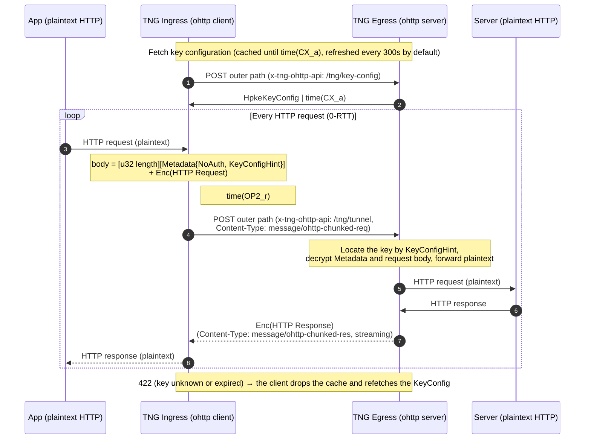

### Outer Request Routing

The egress does not select APIs by URL path: it does not match the outer path at all. All requests go to a single handler that dispatches on the **`x-tng-ohttp-api` request header**. The header's values are path-shaped constants such as `/tng/key-config`, but they are only API selectors and have nothing to do with the request's actual URL. A request without the header is rejected (403, `RejectNonTngRequest`).

The ingress POSTs every outer request to **the same URL** (`base_url`): the outer path comes from `path_rewrites` regex substitution, or from `path_default` (default `root`, meaning `/`; can be set to `original` to follow the business request path). Key-config fetches, tunnel requests, and RA forwarding all go to this URL and are distinguished solely by the `x-tng-ohttp-api` header.

| `x-tng-ohttp-api` header value | Actual client behavior | Request body | Description |
|---|---|---|---|
| `/tng/key-config` | POST (JSON) | `KeyConfigRequest` | Fetch the key configuration, [see below](#key-configuration-distribution) |
| `/tng/tunnel` | POST | Metadata frame + ohttp ciphertext | The encrypted business request, [see the encapsulation section](#encapsulating-the-encrypted-request) |
| `/tng/background-check/challenge` | GET | none | Fetch a challenge from the AS via the egress (Server-verifies-Client + Background-Check only) |
| `/tng/background-check/verify` | POST (JSON) | `AttestationVerifyRequest` | Submit Evidence to the AS via the egress to obtain an Attestation Result (same scenario) |

The egress does not validate the HTTP method; the table above describes what the ingress client actually does. Beyond these two headers there is a separate REST control plane for operators (`/status/egress/<id>/ohttp/keys` and friends), unrelated to the data-plane protocol; see [Control Interface](configuration.md#control-interface).

### Key Configuration Distribution

Before encrypting the first request, the ingress fetches the KeyConfig from the egress (1-RTT, response cached). Both request and response are JSON.

Request body `KeyConfigRequest`:

| Field | Type | Default | Description |
|---|---|---|---|
| `attestation_request` | object | — | Omitted to request no server attestation (`attestation_info` comes back null). Otherwise one of the `model`-tagged variants below |

The two `attestation_request` variants:

```json
{ "attestation_request": { "model": "passport" } }
```

```json
{ "attestation_request": { "model": "background_check", "challenge_token": "<challenge JWT obtained from the AS>" } }
```

Response body `KeyConfigResponse`:

| Field | Type | Default | Description |
|---|---|---|---|
| `hpke_key_config.expire_timestamp` | integer | — | When the configuration expires (Unix seconds); after this the egress no longer accepts requests sealed with the key |
| `hpke_key_config.encoded_key_config_list` | string | — | The RFC 9458 §3.1 KeyConfig encoding as a list, base64 as a whole; the current implementation always carries exactly one key |
| `attestation_info` | object / null | null | Server attestation information, one of the `model`-tagged variants below |

The two `attestation_info` variants:

```json
{ "model": "passport", "attestation_result": "<the egress's own Attestation Result JWT>", "as_provider": "coco" }
```

```json
{ "model": "background_check", "evidence": "<Evidence JSON produced by the egress>", "aa_provider": "coco" }
```

`as_provider` / `aa_provider` mark which provider the token/evidence belongs to (the same string values as the RA config providers, currently `coco` and `ita`), letting the peer pick the matching verification stack; they may be omitted for legacy clients.

The two models are mutually exclusive: requesting `passport` from a background-check server (or vice versa) returns an error. A server without RA configured returns `attestation_info: null`.

**Key lifecycle and rotation.** The egress's HPKE private keys come from three sources (`ohttp.key.source`): `self_generated` (default, automatic rotation, `rotation_interval` defaults to 300 seconds), `file` (loaded from an external file, hot-reloaded via inotify), and `peer_shared` (cluster-wide keys shared over the Serf gossip protocol, for stateless clusters). A key moves through Pending/Active/Stale states: when the rotation interval elapses, the current key becomes Stale (still decryptable) and a fresh Active key is generated; after another interval the old key expires for good. `expire_timestamp` is the key's final expiry time.

The ingress caches the key configuration. The cache's validity is the minimum of the key's `expire_timestamp` and the Attestation Result's JWT `exp`, refreshed automatically in the background (300-second cycle by default; when `attest` is configured it follows the attestation refresh strategy). When the egress receives a request sealed with a key that no longer exists it returns 422 (following the key-config mismatch semantics of RFC 9458 §6.4), upon which the ingress immediately drops its cache and refetches.

### Encapsulating the Encrypted Request

The request body for `x-tng-ohttp-api: /tng/tunnel` is not JSON. It is three concatenated binary sections:

```text
[4-byte big-endian length N][N bytes of prost-encoded Metadata][ohttp-chunked encrypted request body (streamable)]
```

The metadata section is defined in `tng/src/tunnel/ohttp/protocol/metadata.proto`:

```proto
message Metadata {
  oneof client_auth {
    NoAuth no_auth = 1;
    AttestedPublicKey attested_public_key = 2;
  }
  ServerKeyConfigHint key_config_hint = 3;
}

message NoAuth {}

message AttestedPublicKey {
  string attestation_result = 1;  // the client's Attestation Result (JWT)
  bytes pk_s = 2;                 // the client's HPKE sender-authentication public key
  string as_provider = 3;         // which AS provider issued attestation_result
}

message ServerKeyConfigHint {
  bytes public_key = 1;           // the server's raw HPKE public key, used for key lookup
}
```

Three points worth noting:

- `key_config_hint.public_key` is the raw bytes of the **server's** HPKE public key, carried in both client-auth modes. RFC 9458's KeyConfig only has a 1-byte key id, which is not unique enough at scale, so the egress looks the key up directly by public key. A request without the hint is rejected (400).
- `client_auth` picks one of two: `NoAuth` (the ingress does not attest itself, an anonymous client) or `AttestedPublicKey` (the ingress proves itself to the egress, see [Server verifies Client](#server-verifies-client)). The choice is not an explicit config knob: an ingress with `attest` configured automatically carries `AttestedPublicKey`, an egress with `verify` configured requires it, and a mismatch is rejected. The wasm ingress is always `NoAuth` due to platform constraints.
- The metadata frame is capped at 32 MiB (the Attestation Result token can be large; putting it in the body rather than an HTTP header is exactly to bypass header size limits). Exceeding it returns 413.

The ciphertext section uses a chunked streaming encapsulation (chunked-ohttp, specified by [draft-ietf-ohai-chunked-ohttp](https://datatracker.ietf.org/doc/html/draft-ietf-ohai-chunked-ohttp) and implemented by the ohttp fork TNG uses): instead of sealing the whole message in a single AEAD operation the way RFC 9458 does, it encrypts the plaintext incrementally in chunks, so a request of any size can be sealed and decrypted while streaming. The outer `Content-Type` is `message/ohttp-chunked-req`, enforced by the egress; anything else returns 400. Responses work the same way: HTTP 200, `Content-Type: message/ohttp-chunked-res`, with the ciphertext streamed back so the ingress decrypts as data arrives (this also covers SSE-style streaming responses). Neither content type is ever compressed.

#### The ohttp-chunked Request Ciphertext

After the metadata frame, the request ciphertext is a single stream:

```text
[key_id 1B][kem_id 2B][kdf_id 2B][aead_id 2B][enc n_enc B][chunk][chunk]...[terminating chunk]
```

- **Request header** (7 bytes): the same field order and encoding as the identifier portion of the RFC 9458 §3.1 KeyConfig, a 1-byte key id followed by 2-byte big-endian KEM, KDF, and AEAD ids. The egress reads it first to locate the key, cross-checked against the metadata's `key_config_hint`. All keys TNG issues use the X25519-SHA256 KEM; the symmetric suites travel with the key configuration (self-generated keys advertise HKDF-SHA256 with AES-128-GCM first and ChaCha20-Poly1305 second, cluster-shared keys advertise only ChaCha20-Poly1305), and the ingress picks the first suite it supports.
- **`enc`**: the HPKE encapsulation that carries the shared secret, `n_enc` bytes (32 for X25519-SHA256). In `AttestedPublicKey` mode the HPKE exchange itself runs in authenticated mode: the ingress encapsulates with the private key paired with `pk_s`, and the egress feeds `pk_s` from the metadata into decapsulation, so only the holder of the attested key can have produced the request.
- **Chunk**: a varint length followed by that many bytes of AEAD ciphertext. The varint uses the 2-bit-prefix encoding of RFC 9292: the first two bits of the first byte give the total width (00 = 1 byte, 01 = 2, 10 = 4, 11 = 8) and the remaining bits carry the value in big-endian order. The length counts ciphertext bytes, which is plaintext plus the AEAD tag (16 bytes for every suite advertised). A data chunk carries at most 16 KiB (2^14) of plaintext; the egress rejects any longer declared length. Each chunk is sealed with its own nonce, the nonce base XORed with the chunk's sequence number counting from 0, so no two chunks of one stream share a nonce. The length prefix itself is not authenticated: only the chunk order (through the per-chunk nonce) and the position of the final chunk (through its AAD) are covered, so the same length value rewritten in a different varint width remains valid.
- **Terminating chunk**: the last chunk carries a varint length of 0, and its ciphertext is exactly the AEAD tag over an empty plaintext. Data chunks use the empty byte string as additional authenticated data (AAD); the terminating chunk uses the ASCII string `final`, which is what marks the end of the stream. It is always present, so the end of the body is authenticated as well; a body that stops before it is rejected as truncated.
- **Plaintext**: the chunked layer is not HTTP-aware. Its plaintext is the inner request re-encoded as binary HTTP (bhttp, RFC 9292), which the chunking splits at arbitrary 16 KiB boundaries; the egress bhttp-decodes the decrypted stream into the request it forwards to the backend.

The HPKE domain-separation strings are the chunked draft's, not RFC 9458's. The request's HPKE info parameter is the ASCII string `message/bhttp chunked request` followed by a zero byte and the 7-byte request header, and the response secret is exported under the label `message/bhttp chunked response`. The non-chunked variant of RFC 9458 uses `message/bhttp request` and `message/bhttp response`; the strings differ by design, so a chunked endpoint and a non-chunked endpoint are not interoperable even with the same key.

#### The ohttp-chunked Response Ciphertext

The response body is:

```text
[response nonce max(n_k, n_n) B][chunk][chunk]...[terminating chunk]
```

The egress first generates a fresh random nonce whose length is `max(n_k, n_n)` of the negotiated AEAD (16 bytes for AES-128-GCM, 32 for ChaCha20-Poly1305), then seals the bhttp-encoded response into chunks. The response key is derived from the request's HPKE context: the shared secret is exported under the chunked response label, then run through HKDF with the request's `enc` and the response nonce as the salt, producing the AEAD key and the nonce base. Both halves of the derivation come from this one request, so the response is cryptographically bound to it. The chunk framing, the terminating chunk, and the per-chunk nonce construction are the same as the request's.

### Choosing an RA Model

The "client verifies server" and "server verifies client" directions each independently pick the background-check or passport model, controlled by the `model` field of the `attest`/`verify` config blocks (defaulting to `background_check` when omitted).

| Dimension | Background-Check (default) | Passport |
|---|---|---|
| Where Evidence is verified | The Verifier side receives Evidence and has the AS verify it | The Attester verifies with the AS up front and obtains a token |
| Who talks to the AS | The verifying side (the Verifier-side TNG) | The proven side (the Attester-side TNG) |
| Round trips per config fetch | Needed (fetch fresh Evidence carrying a challenge) | Not needed (the token ships with the config) |
| Freshness source | The AS challenge JWT (short validity) | The token's own exp |
| AS placement constraint | The AS must be reachable by the verifying side (in-process when `as_type: "builtin"`) | The AS must be reachable by the proven side |
| Typical scenario | The verifier can reach the AS and wants strong freshness | The attester is close to the AS, the verifier is network-isolated |

Two clarifications:

- `as_type: "builtin"` (the built-in AS) is not a third model. It is an AS implementation choice on the verify side of the background-check model: the verification logic is linked into the TNG process and runs in-process, with no external AS to deploy. The passport model's attest side does not support the builtin converter.
- In the server-verifies-client direction with the background-check model, the AS must be reachable from the egress. In a stateless cluster the ingress cannot assume which egress it will land on, so this direction offers a "forwarded via the egress" variant (below).

### Timestamp and Message Notation

The RA sequence diagrams below use a formal notation aligned with the event table of RFC 9334 Appendix A:

- `time(XX_y)` is the time event XX happens, where `y` is the involved party (`a`: Attester, `v`: Verifier, `r`: Relying Party).
- A form like `JWT{Nonce, time(NS_v), time(NX_v)}` describes the material a message carries together with its validity fields; `|` separates the parallel pieces of material inside one message; `Enc(x)` is `x` after HPKE encryption.
- Protocol objects in the diagrams use CamelCase consistently, mapped to the wire-format field names in the body sections: `Challenge` is the challenge token `JWT{Nonce, time(NS_v), time(NX_v)}` (wire field name `challenge_token`); `Claims` is the claim set the proven side binds into the Evidence, which the AS writes back into the token after verification (wire field name `runtime_data`), where "Claims covers {…}" is set inclusion (every expected key/value appears in the token); `Evidence{hash(…)}` means the Evidence binds the hash of the Claims in parentheses into the TEE report data (the AA hashes the canonical JSON of the Claims as a whole) while the plaintext Claims travel alongside the Evidence; `skS`/`pkS` are the client's HPKE sender-authentication key pair in the server-verifies-client direction; `HpkeKeyConfig` is the key configuration object (wire field name `hpke_key_config`).

How the diagram events map to the implementation:

| Event | Meaning | Implementation |
|---|---|---|
| NS / NR | challenge sent / received | challenge JWT issuance (`iat`) and arrival |
| NX | challenge expiry | the challenge JWT's `exp` |
| EG / ER | Evidence generated / received | the AA collecting hardware measurements and binding the claims / the peer receiving the Evidence |
| RG / RX | Attestation Result generated / expiry | the AS issuing the token / the token's `exp` |
| RA | Attestation Result accepted | the verifier's signature and claims-coverage check passing |
| CX | KeyConfig expiry | `hpke_key_config.expire_timestamp` |
| OP2 | cryptographic operation based on the verified result | the moment HPKE encryption/decryption runs after verification |

The diagrams express message contents with this formal notation; the concrete wire formats (JSON field names, the proto structure, Content-Types) are in [Key Configuration Distribution](#key-configuration-distribution) and [Encapsulating the Encrypted Request](#encapsulating-the-encrypted-request).

### Client Verifies Server

#### Background-Check Model (Default)

The ingress (Relying Party) obtains a challenge from the AS, uses it to fetch fresh Evidence from the egress (Attester), and has the AS verify it. Every key-config fetch gets fresh Evidence; freshness is guaranteed by the challenge JWT:

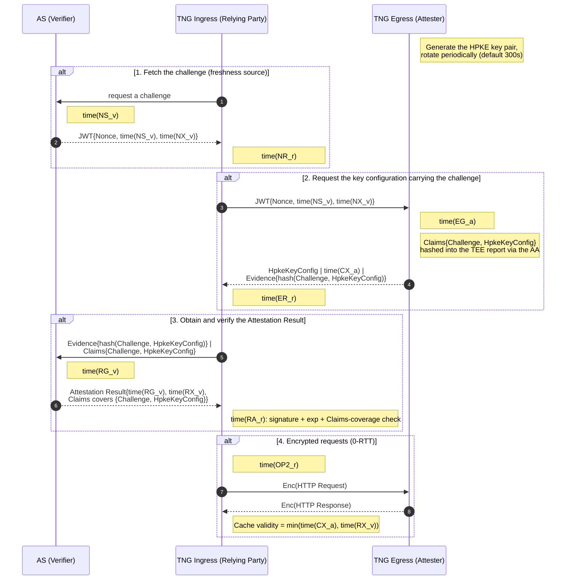

In step 3, if the ingress has `as_type: "builtin"` configured, the AS role runs inside the ingress process (the diagram's AS participant becomes an in-process component); the message semantics are unchanged.

#### Passport Model

The egress obtains its own Attestation Result up front and distributes it with the KeyConfig; the ingress only verifies the token and never touches raw Evidence:

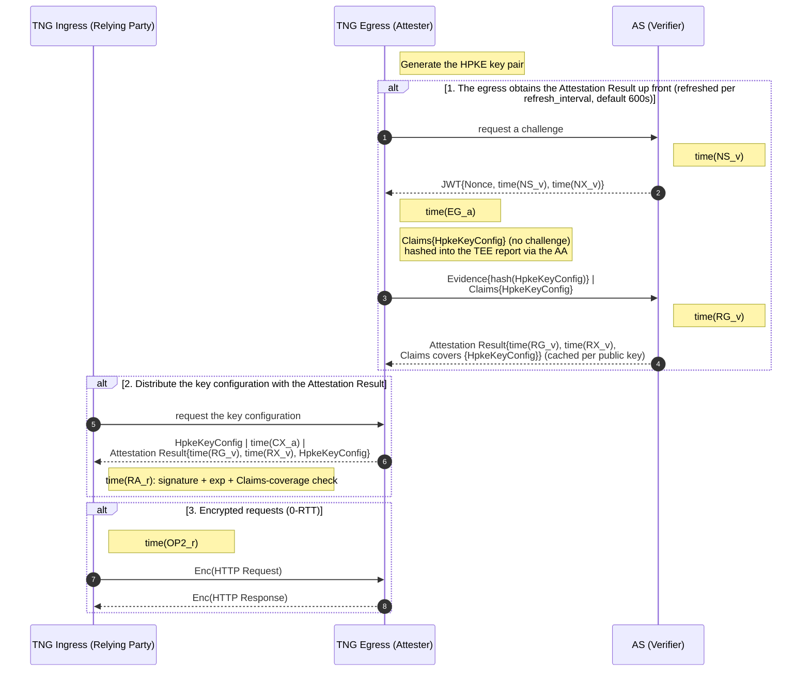

The egress caches passport tokens per key generation: after a key rotation the old token is no longer distributed, and tokens refresh on the `refresh_interval`.

#### How the attested material binds the key configuration

The binding mechanism is the same in both models, and it is what "a verified KeyConfig" cryptographically means:

1. The proven side puts a claims object into the Evidence's runtime_data. In the client-verifies-server direction it is `ServerUserData{challenge_token, hpke_key_config}` (no challenge_token in the passport model); in the server-verifies-client direction it is `ClientUserData{challenge_token, pk_s}`. Note `hpke_key_config` is the **complete configuration object** (including the base64 key list), not a hash of it.
2. The AA hashes the canonical JSON serialization of the whole claims object (SHA-384 in the current implementation) into the TEE report data, so the hardware ties the claims to the Evidence inseparably.
3. After verifying the Evidence, the AS writes the same claims back into the Attestation Result's runtime_data.
4. The verifier checks the token: the signature trust chain (AS certificate or JWK), the validity window (JWT exp), and that the runtime_data **covers** the expected claims (a subset match: every expected key/value must appear in the token).

Together, the token the verifier receives proves both "the peer runs in a trusted environment" and "the key material the peer uses for this handshake comes from that environment"; the two are bound by the hardware measurement and cannot be forged separately.

### Server Verifies Client

#### Passport Model

The ingress generates an X25519 key pair (`skS`/`pkS`) for itself, obtains an Attestation Result from the AS with `pk_s` bound into the claims up front, and presents it on every request:

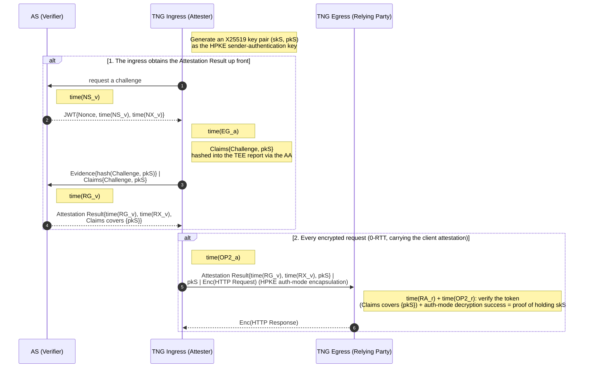

The egress's verification has two layers, both required:

- **Token layer**: the metadata frame's `attestation_result` and `pk_s` go through the same subset check as the previous section (the expected claims are `{pk_s}`; the challenge token is not re-checked because the AS already checked it at issuance).
- **Cryptographic layer**: the client encapsulates the request in HPKE **sender-authenticated mode** (RFC 9180 auth mode, the `SetupAuthS` semantics), with the attested `skS` as the authentication key. The egress completes the auth-mode decapsulation using the `pk_s` from the metadata frame; successful decryption is the cryptographic proof that the sender holds `skS`. The token binds `pk_s`, the decryption proves `skS`, and together they tie "the trusted environment" to "the sender of this connection".

Without client attestation (`NoAuth`) the base HPKE mode is used. The wasm ingress does not support `attest` and is always `NoAuth` in this direction.

#### Background-Check Model (the forwarded variant)

A strict background-check model would have the egress go to the AS itself after receiving a request, but that would put verification latency on the business request path. TNG moves the exchange **up front** to handshake time and keeps the egress as a pure forwarder: the AS's challenge/attestation interfaces are forwarded verbatim through the egress, and the ingress completes its proof through them. The ingress therefore does not need to know which egress it will land on (friendly to stateless clusters), and the egress stays stateless:

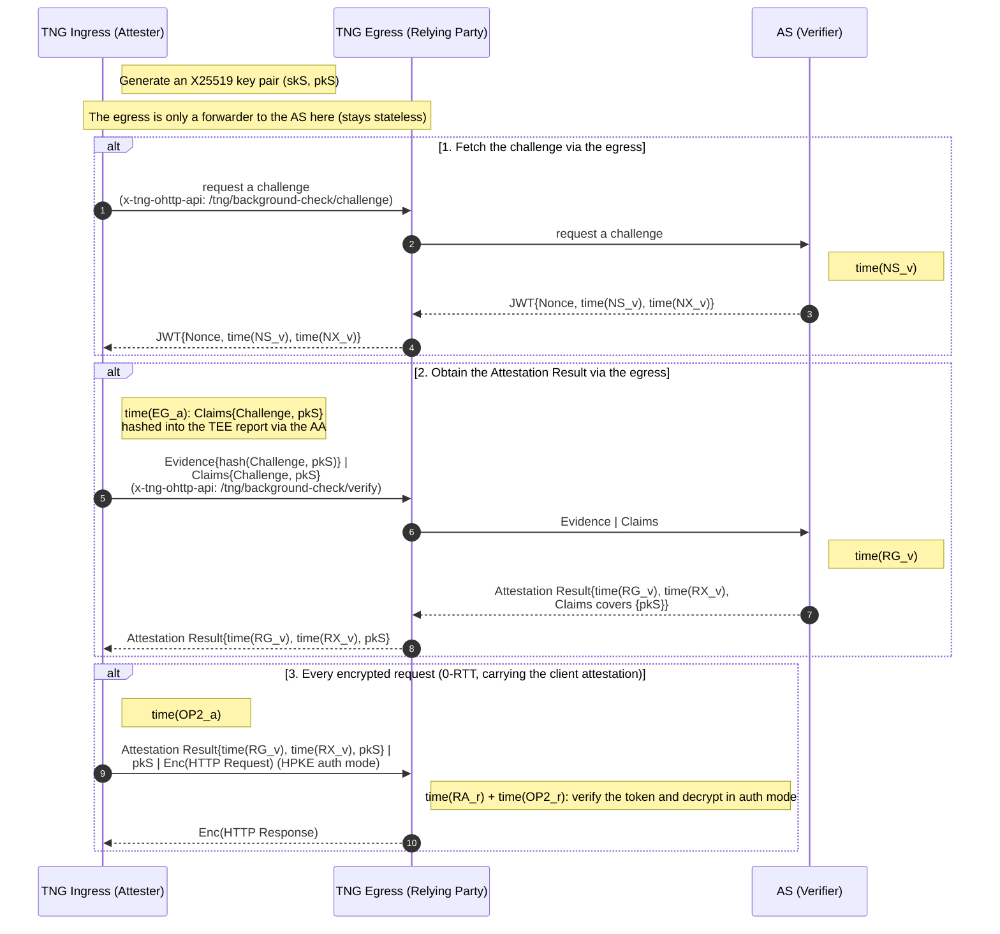

When the egress is configured for the passport model these two forwarding endpoints return an error. The forwarded request/response fields map one-to-one to the AS interface (`AttestationChallengeResponse{challenge_token}`, `AttestationVerifyRequest{evidence, aa_provider}`, `AttestationVerifyResponse{attestation_result, as_provider}`).

### Bidirectional Verification

The two directions produce complementary artifacts: client-verifies-server yields "a verified KeyConfig", and server-verifies-client yields "an Attestation Result bound to `pk_s` plus proof of auth-mode key possession". They stack without interfering; configure `attest` + `verify` on both the ingress and the egress, with the model chosen independently on each side:

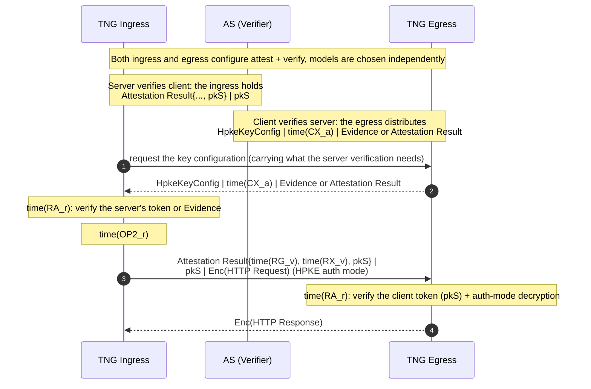

### Freshness and Replay

Every short-lived credential in the protocol has an explicit expiry semantics:

| Credential | Produced by | Validity | On expiry |
|---|---|---|---|
| Challenge JWT (wrapping the nonce) | AS | Set at issuance (the Trustee implementation uses 5 minutes) | The AS rejects the Evidence at verification, HTTP 401 |
| Server KeyConfig | egress | `expire_timestamp` (one and a half rotation intervals under auto-rotation) | 422, the client refetches |
| Attestation Result | AS | JWT `exp` | The verifier rejects it; the ingress cache expires early |

On replay, the implementation's strategy is:

- The challenge JWT is checked for signature and exp only; there is **no** server-side used-token list. The AS is therefore fully stateless (free to scale horizontally); replay protection relies on the short exp window plus the challenge being measured into the Evidence by the TEE.
- Encrypted requests are 0-RTT, so a replay window exists in theory (the same class of issue as TLS 1.3 0-RTT). The current implementation does not deduplicate request ciphertexts, following RFC 9458's stance on replay: requests should be idempotent or protected at the business layer. Response keys are derived from the request keys with a one-time nonce, so responses are not replayable.

### AS Interface

The interfaces below are what TNG uses to talk to an external restful AS in the background-check model (the passport model's interactions are identical; only the initiator is the proven side). They match Trustee's restful AS:

| Endpoint | Method | Request body | Response |
|---|---|---|---|
| `/challenge` | POST | `{}` | JSON `{nonce, extra-params: {jwt}}` |
| `/attestation` | POST | JSON (Evidence, runtime_data, policy_ids) | **the raw JWT string** (not JSON-wrapped) |
| `/certificate` | GET | none | The AS's token-signing certificate chain, used to bootstrap the verifier's trust |

Two notes:

- The `/attestation` request body follows Trustee's restful AS schema (the `verification_requests` array structure on newer versions, with automatic fallback to the flat structure for older AS deployments); its definition lives in Trustee's `attestation.proto` and is not restated here.
- The AS certificate can also be pinned instead of discovered via `/certificate`: list PEM files under `trusted_certs_paths` in the verify config.

An `as_type: "grpc"` AS does not support the challenge endpoint (the client falls back to a dummy nonce, degrading freshness); with `as_type: "builtin"` all of the above execute inside the TNG process with no network calls.

### Error Responses

On data-plane errors the egress returns a JSON body `{"code": "<machine-readable code>", "message": "<human-readable description>"}`. Common status codes:

| HTTP status | Trigger |
|---|---|
| 400 | Content-Type is not `message/ohttp-chunked-req`; metadata frame decoding failed; key_config_hint missing |
| 403 | The request lacks the `x-tng-ohttp-api` header |
| 413 | The metadata frame exceeds 32 MiB |
| 422 | The key pointed to by key_config_hint does not exist or has expired (RFC 9458 §6.4) |
| 500 / 502 / 504 | Internal error / upstream unreachable / upstream timeout |

A failed client attestation (the verify side's token check failing) flows through the same JSON error channel.

## RATS-TLS Tunnel Protocol

### Roles and Protocol Layering

The rats-tls tunnel encrypts at the granularity of a **TCP connection**: in non-multiplexed mode, every captured client connection maps to one independent TLS 1.3 session between the ingress and the egress (the ingress is always the TLS client, the egress always the TLS server). Where ohttp carries the RA material in the HTTP payload, rats-tls carries it inside the **X.509 certificate** of the TLS handshake: the proven side generates an ECDSA P-256 key pair and a self-signed DICE certificate, puts the RA material into a custom certificate extension that travels in the `Certificate` message, and the `CertificateVerify` signature over that private key binds the material to the live connection of the handshake.

The wire protocol itself is **unmodified standard TLS 1.3**: no custom handshake messages, no supplemental data, no RA-specific TLS extension. TNG's only change to rustls is raising the per-message and certificate size caps (TEE evidence plus the event log pushes the certificate past the upstream 64 KiB DoS limits, in combination with RFC 8879 certificate compression). RA verification happens **after the handshake completes and before any business data is forwarded**: the rustls-level certificate verifiers unconditionally pass during the handshake, the real appraisal is done by TNG afterwards, and a failure simply drops the connection. The data-plane shape is decided by ALPN: `rats-tls` (non-multiplexed) or `h2` (multiplexed, see [Multiplexed and Non-Multiplexed](#multiplexed-and-non-multiplexed)).

Start with an overview diagram without remote attestation (notation follows [Timestamp and Message Notation](#timestamp-and-message-notation)):

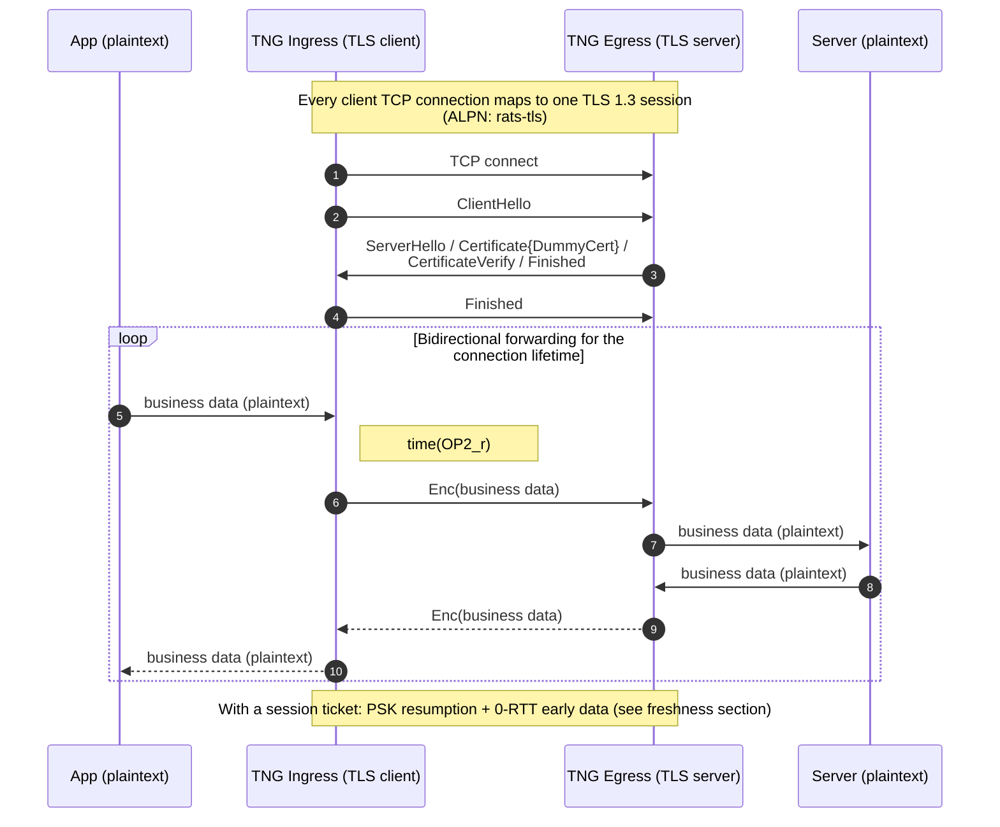

In no_ra mode both ends use a fixed self-signed DummyCert built into the binary, which provides encryption and integrity but no identity or RA guarantees at all. It is for debugging only and should not be used in production. `Enc(x)` in the diagrams is `x` after TLS record-layer encryption.

### Handshake Message Flow and Direction Combinations

The message order is a completely standard TLS 1.3 flow (ClientHello → ServerHello → EncryptedExtensions → [CertificateRequest] → Certificate → CertificateVerify → Finished → [client Certificate → CertificateVerify → Finished]) with RFC 8879 certificate compression enabled. The RA-relevant differences only show up in **who presents a certificate carrying RA material, who sends the CertificateRequest, and who verifies after the handshake**:

| Direction | Ingress config | Egress config | CertificateRequest | Egress presents | Ingress presents | Post-handshake verifier |
|---|---|---|---|---|---|---|
| Unidirectional (client verifies server) | `verify` | `attest` | no | DiceCert | empty certificate | ingress |
| Reverse unidirectional (server verifies client) | `attest` | `verify` | yes | DummyCert | DiceCert | egress |
| Bidirectional | `attest` + `verify` | `attest` + `verify` | yes | DiceCert | DiceCert | both sides |
| no_ra (debugging) | `no_ra` | `no_ra` | no | DummyCert | empty certificate | none |

Mismatched combinations fail inside the TLS handshake itself: for example a `verify` egress (which demands a client certificate) facing an ingress without `attest` (which presents an empty certificate) is rejected by rustls with `NoCertificatesPresented`. In the reverse-unidirectional row the egress does no RA, presents the DummyCert, and uses CertificateRequest to demand the ingress's DiceCert.

### DICE Certificate: The Carrier of the Attested Material

The DICE certificate is the sole carrier of RA material in rats-tls. Its generation and binding mechanism (same notation as the ohttp sections):

1. The proven side generates a P-256 key pair and puts the SHA-256 of the public key, as `PubKeyHash`, into the Claims (report-data claims). In the passport model the AA→AS pipeline then runs up front to obtain the Attestation Result, with the same Claims measured into the TEE report.
2. The AA collects the Evidence with those Claims, `Evidence{hash(PubKeyHash)}`, same convention as in the ohttp section: the TEE report data binds the hash of the whole canonical-JSON Claims, with the plaintext traveling alongside.
3. The material is serialized as tagged CBOR (raw AA Evidence in the background-check model, the AS token in the passport model) and written into the self-signed certificate's custom extension (OID 2.23.133.5.4.9, TCG DICE Tagged Evidence).
4. The certificate is self-signed with a fixed CN and a 6-hour validity (the passport model takes the minimum with the token's `exp`), compressed to control the handshake size. The private key never leaves the proven side.

The verifier's post-handshake check:

1. Verify the certificate's **self-signature** (there is no external PKI chain; the trust anchor is the TEE measurement, not a certificate chain).
2. Parse the extension, extract the material and the accompanying Claims, and recompute the expected `PubKeyHash` from the certificate's public key.
3. Background-check model: submit the Evidence with the Claims to the AS synchronously for a token; passport model: the material is already the AS token, no AS round trip.
4. Verify the token: signature trust chain (AS certificate/JWK), `exp`, Claims covering `{PubKeyHash}` (the same subset check as ohttp). A pass is cached by certificate hash for 60 seconds.

This is exactly isomorphic to ohttp's `pkS`/`skS` two-layer structure, and it is what "a verified connection" cryptographically means:

- **Token layer**: the Attestation Result's Claims cover `{PubKeyHash}`, proving "this public key comes from a trusted environment".
- **Cryptographic layer**: the TLS `CertificateVerify` is signed by the certificate's private key; verifying it is the cryptographic proof that the peer holds the private key matching `PubKeyHash`.

The token binds the public-key hash, the handshake proves private-key possession, and together they tie "the trusted environment" to "this TLS connection", not forgeable separately.

### Multiplexed and Non-Multiplexed

| Dimension | Non-multiplexed (default) | Multiplexed |
|---|---|---|
| ALPN | `rats-tls` | `h2` |
| Connection model | one client connection = one TLS session | one outer TLS session carries all traffic; each client connection is one HTTP/2 CONNECT stream on it |
| RA | each session presents and verifies its own certificate | the outer handshake presents and verifies once; the CONNECT response carries the verdict |
| Session resumption | PSK tickets + 0-RTT early data | a single long-lived connection, no 0-RTT |
| Throughput profile | independent crypto per connection, naturally parallel | all traffic shares one connection's crypto capacity (see the capacity notes in the parameter manual) |

Multiplexing requires the ingress and egress `multiplex` flags to agree, otherwise ALPN negotiation fails; all RA is carried by the outer handshake, and the inner CONNECT streams carry no attested material. The ingress-side pool shards per destination endpoint (`multiplex_max_connections`) with a per-shard concurrent-stream cap (`multiplex_max_streams_per_connection`), opening a new shard at the cap; these are throughput knobs whose semantics live in the [Parameter Manual](configuration.md#transport-layer-common-configuration).

### The RA Models in rats-tls

Both the background-check and passport models apply to rats-tls, and they are **indistinguishable on the wire**: the TLS message flow, the certificate structure, and the extension OID are identical; the difference is only what the certificate extension carries (the AA's Evidence or the AS's token) and when the AS is called (by the verifying side after the handshake, or by the proven side before it). The model comparison table in [Choosing an RA Model](#choosing-an-ra-model) carries over. Two rats-tls-specific constraints: the `model` on the attest side and the verify side must match, and the builtin AS is only usable on the verify side of the background-check model (a passport attest + builtin combination is rejected).

### Client Verifies Server

#### Background-Check Model (Default)

The egress prepares a DiceCert carrying Evidence before the handshake; the ingress has the AS verify it after the handshake:

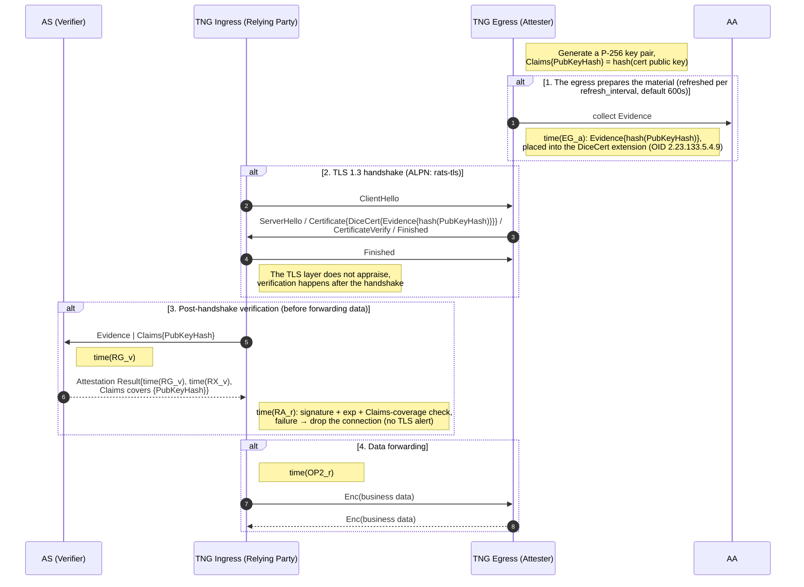

If the ingress has `as_type: "builtin"` configured, the AS role in step 3 runs inside the ingress process with no network round trip.

#### Passport Model

The egress obtains the token up front and bakes it into the certificate; the ingress verifies the token after the handshake with no AS round trip:

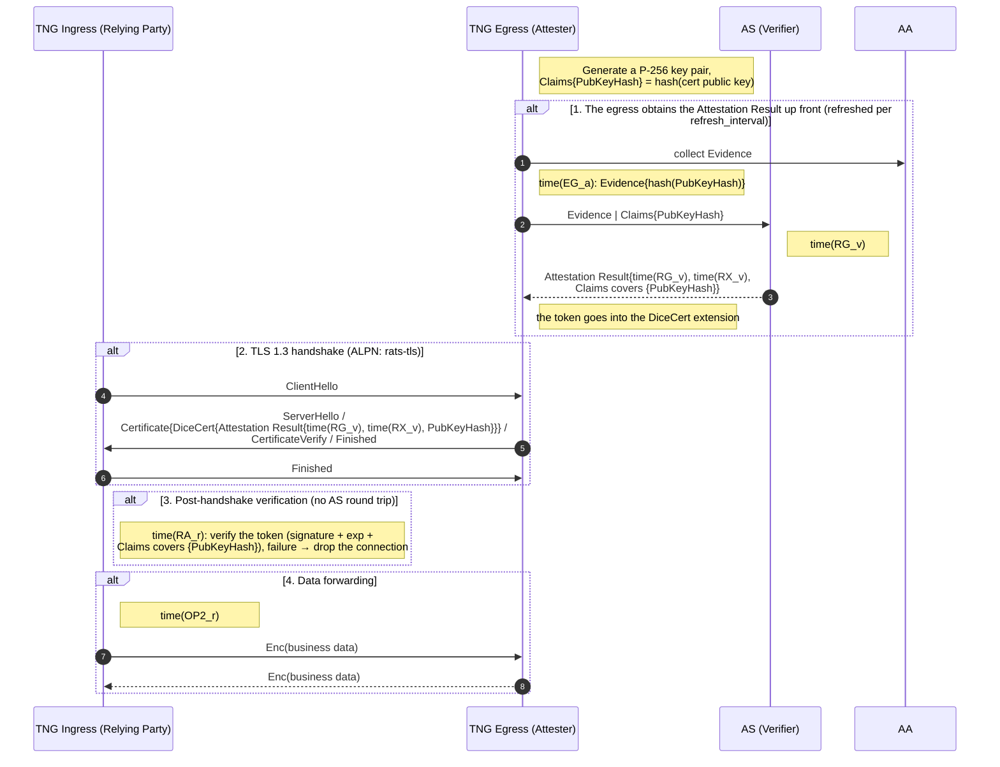

### Server Verifies Client

#### Passport Model

The ingress obtains the token up front and bakes it into its own DiceCert; the egress demands the client certificate during the handshake and verifies it afterwards:

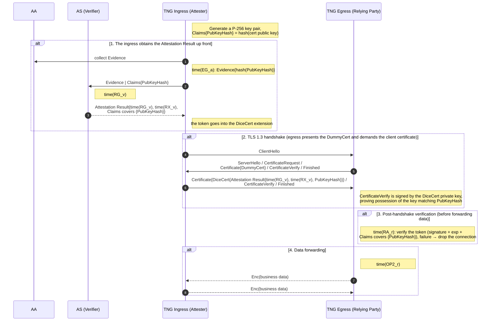

#### Background-Check Model

The flow has the same shape as the passport model, with two differences: the ingress bakes the AA's Evidence (not a token) into the certificate, and the egress submits the Evidence with the Claims to the AS for a token after the handshake (the AS must be reachable from the egress):

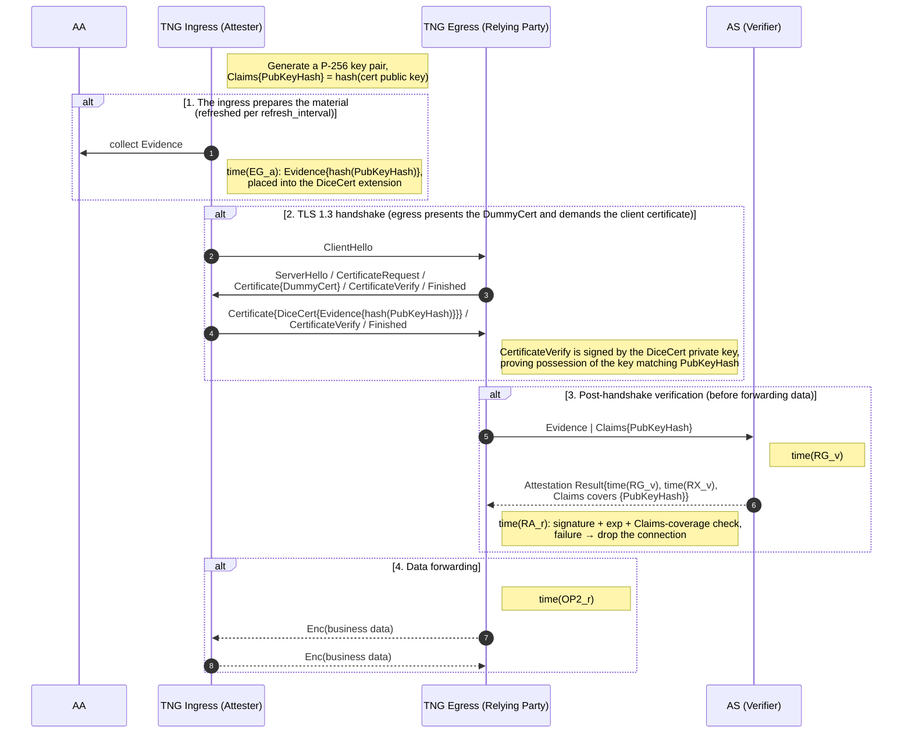

Unlike ohttp's background-check forwarding variant, there is **no** "forwarded via the peer" variant here: rats-tls is a connection-level protocol where the ingress connects to the egress directly, so the stateless-cluster problem of "not knowing which egress you will land on" does not exist.

### Bidirectional Verification

The two directions stack: the egress presents a DiceCert while demanding the ingress's DiceCert via CertificateRequest, and both sides verify the peer's certificate after the handshake:

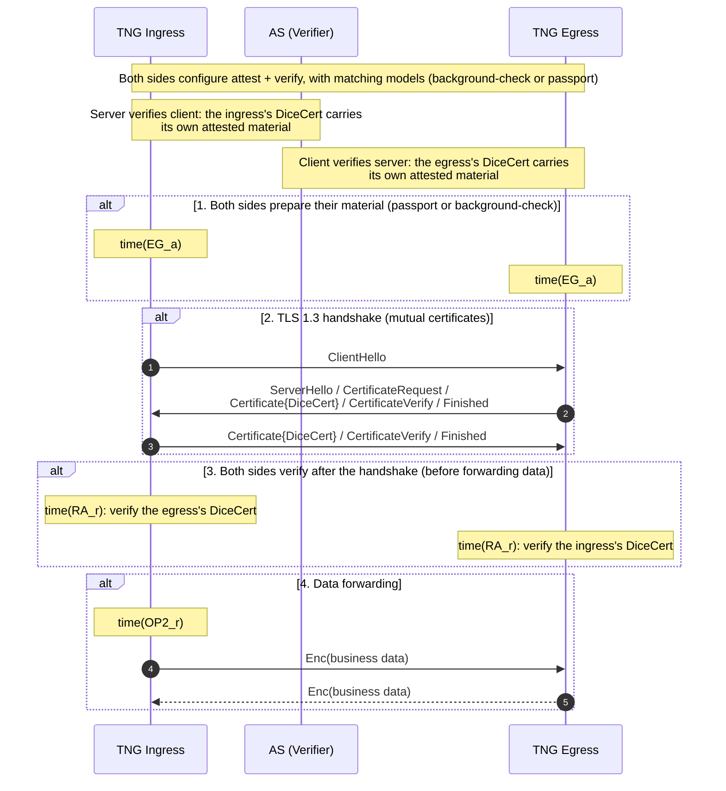

### Freshness and Session Resumption

The rats-tls path has **no per-handshake challenge** (`time(NS_v)` / `time(NX_v)` never appear: the AS's challenge interface is only used by the ohttp background-check flow). Freshness is instead a stack of time windows:

| Mechanism | Period / meaning |
|---|---|
| Material refresh | attest-side `refresh_interval` (default 600 seconds, 0 = regenerate on every handshake) |
| Verdict cache | verify-side 60 seconds (the same certificate is not re-appraised within a minute) |
| Token validity | the AS token's `exp` |
| Certificate validity | 6 hours (the passport model takes the minimum with the token's `exp`) |

The trust of a resumed (PSK) or 0-RTT session is **inherited from the original full handshake**: a resumed connection does not re-run the RA appraisal; the Resumed state trusts the PSK binding to the original verification. A client holding a session ticket may send up to 64 KiB of early data before the handshake completes (the egress accepts up to 128 KiB; rejected 0-RTT is automatically replayed as 1-RTT). Compared with ohttp's challenge JWT there is no per-handshake freshness source here; the cost is a staleness window of at most one refresh interval on the material, and the gain is zero extra round trips on resumed connections.

### Handshake Failure and Error Behavior

- **RA verification failure**: no alert at the TLS layer; the connection is dropped after the handshake and before any data is forwarded, and the peer observes a closed connection or TCP reset rather than a TLS error.
- **Mismatched configurations**: fail inside the TLS handshake, for example a `verify` egress facing an ingress without `attest` (empty client certificate) is rejected by rustls with `NoCertificatesPresented`.
- **The UDP tunnel path (QUIC) is the exception**: its certificate verifiers run synchronously inside the handshake, and a failure surfaces as a TLS-level invalid-certificate error.
