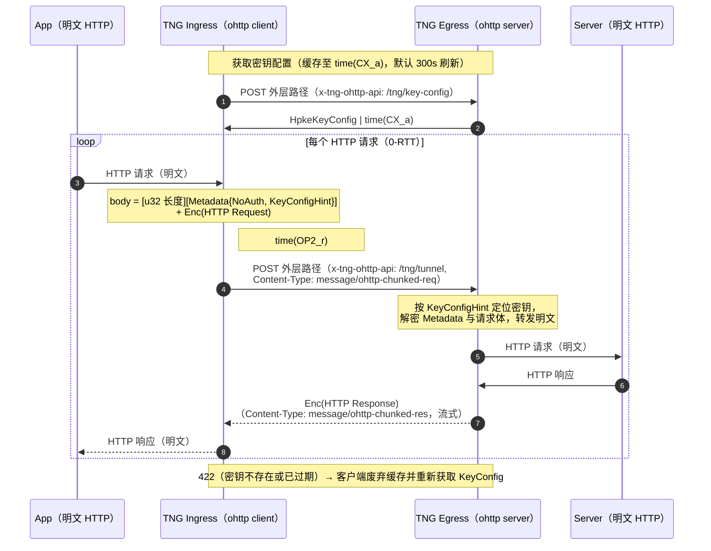
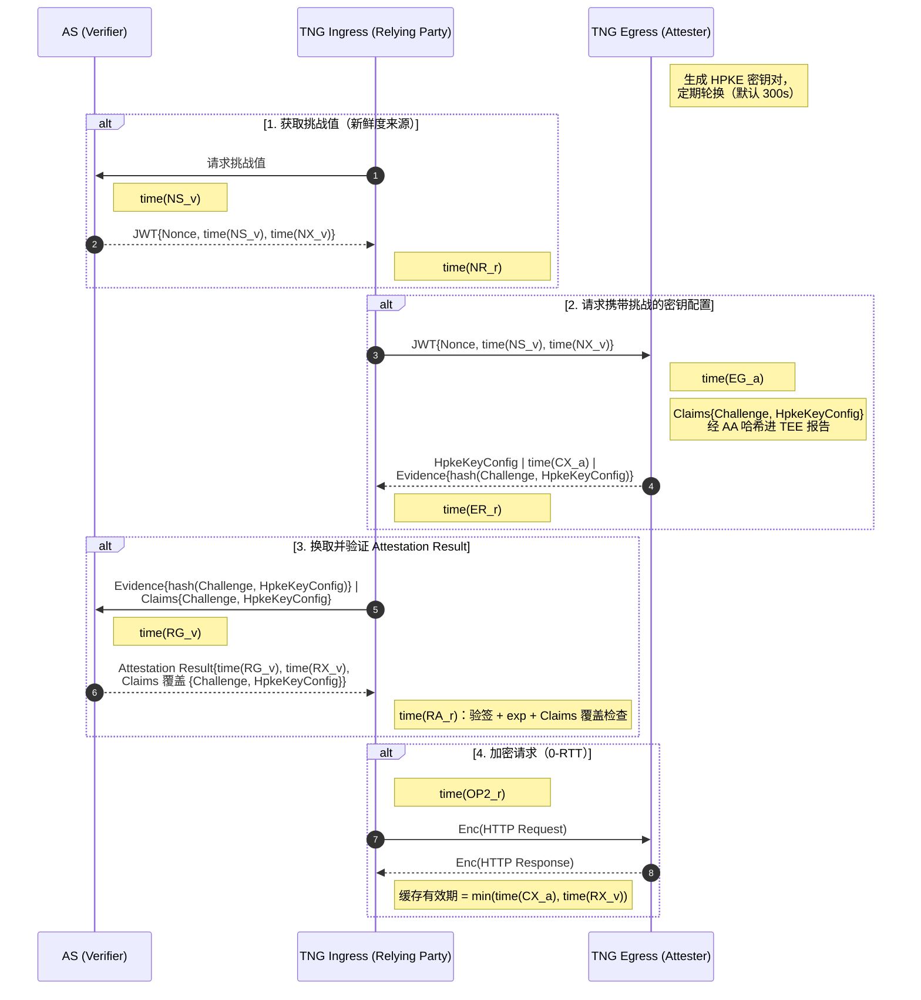
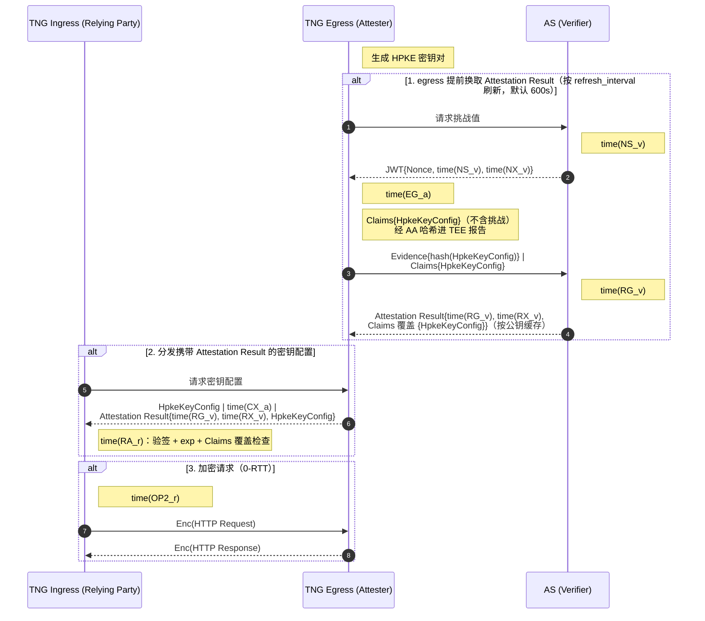
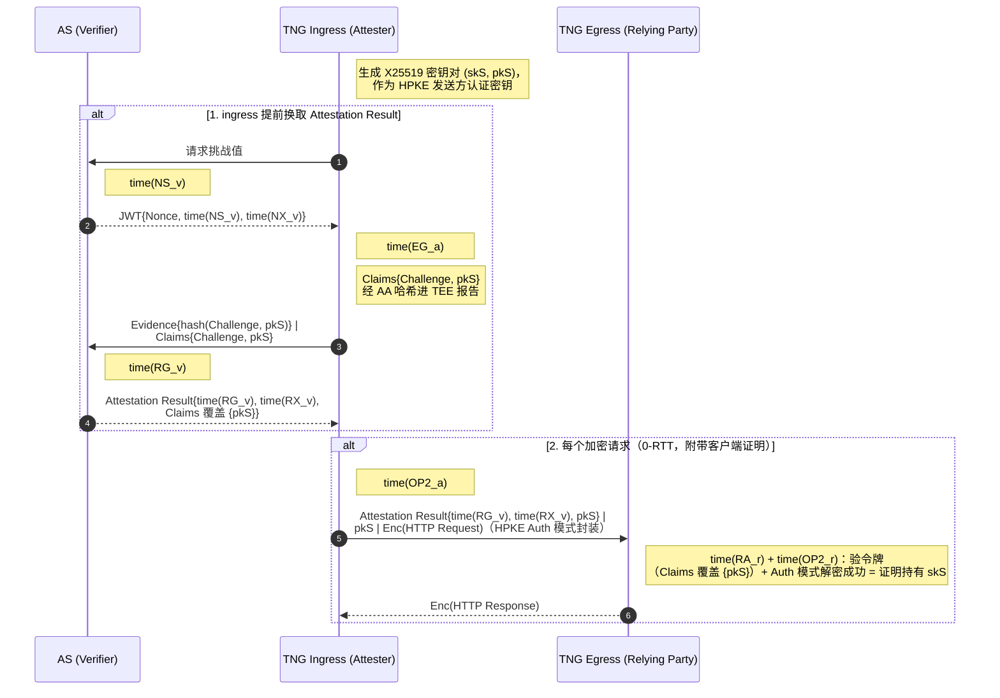
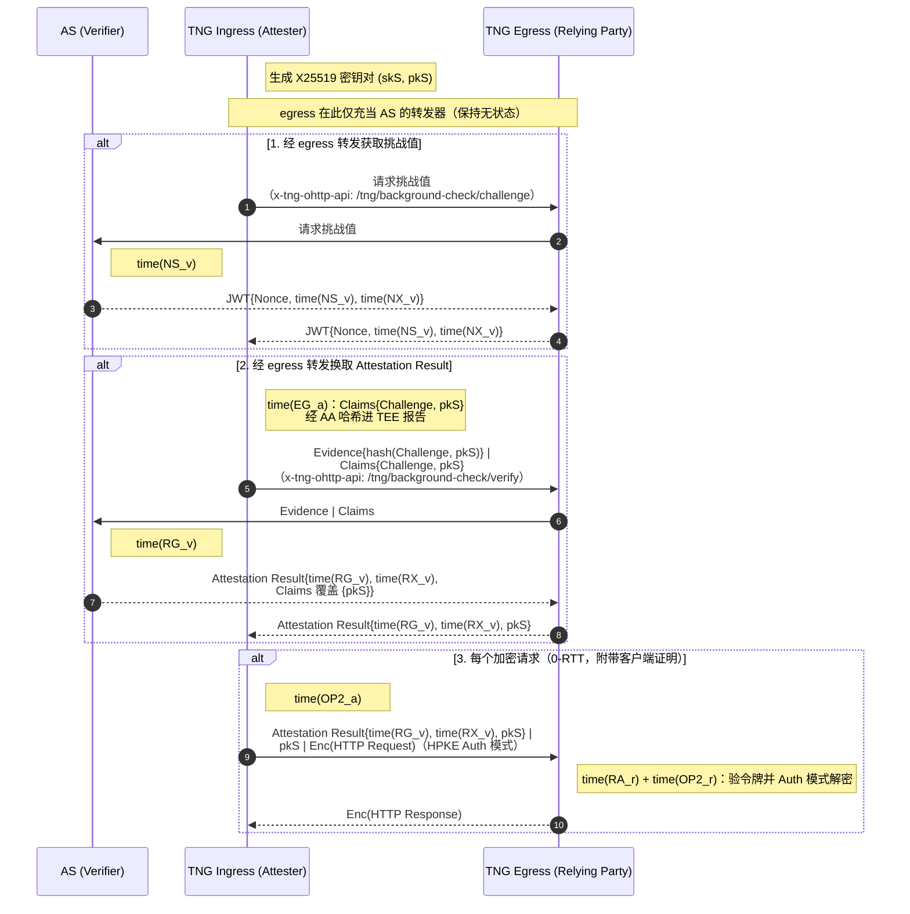
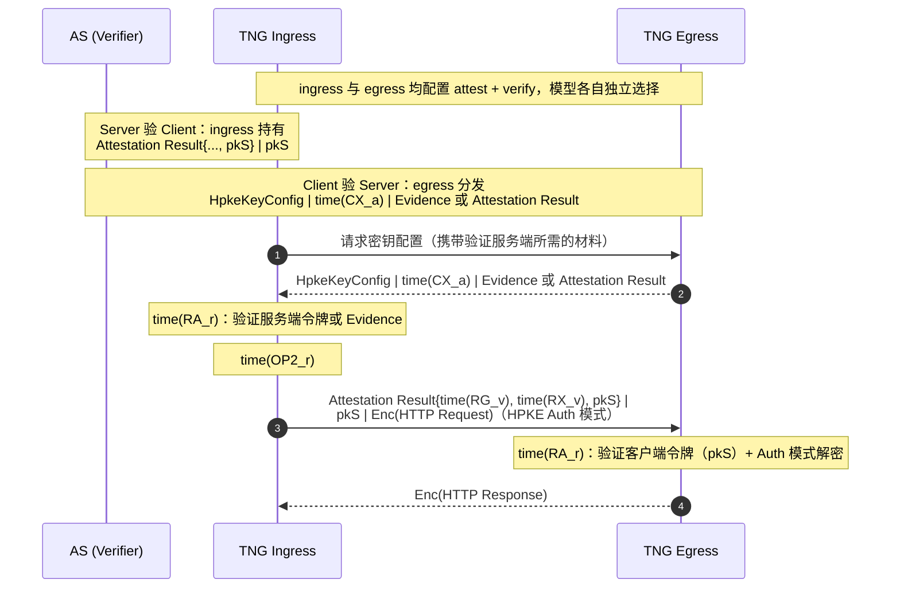

# TNG 隧道协议与远程证明握手

本文面向开发者与希望深入理解 TNG 的读者，描述两个 TNG 端点之间建立互信并交换加密流量的协议细节：握手如何与远程证明结合、双方交换哪些消息、以及外层 HTTP 的线格式。配置字段与部署方法不在本文范围内：配置参考见[参数手册](configuration.md)，远程证明的配置细节见[远程证明配置](remote_attestation.md)，整体概念见[核心概念与工作流程](architecture.md)。

本文当前覆盖 **ohttp 隧道**；rats-tls 的握手细节将在后续修订中补充到同一文档。

术语约定：本文用 **TNG Ingress**（隧道入口，业务流量进入的一端）与 **TNG Egress**（隧道出口，业务流量发出的一端）称呼两个端点。在一次单向证明中，被证明的一端是 RFC 9334 意义上的 Attester，验证的一端是 Verifier（其 Relying Party 角色由 TNG 自己充当）。

## 术语速查

| 术语 | 含义 |
|---|---|
| AA (Attestation Agent) | 运行在 TEE 内的代理，采集硬件度量并生成 Evidence |
| AS (Attestation Service) | 验证 Evidence 的后端服务，签发 Attestation Result；可以是外部进程（Trustee）或 TNG 内置（`as_type: "builtin"`） |
| Attester | 生成 Evidence 的一端（RFC 9334 角色） |
| Verifier | 验证 Evidence 的一端（RFC 9334 角色） |
| Evidence | Attester 产出的、描述其软硬件环境的密码学证明材料 |
| Attestation Result | AS 验证 Evidence 后签发的结果令牌，TNG 中为 JWT |
| 背调模型 (Background-Check) | RFC 9334 模型之一：Attester 把 Evidence 直接交给 Verifier 一侧，由它请 AS 验证 |
| 护照模型 (Passport) | RFC 9334 模型之一：Attester 预先向 AS 换取 Attestation Result，之后把令牌当作「护照」出示 |
| HPKE | RFC 9180 混合公钥加密，ohttp 封装的密码学基础 |
| KeyConfig | RFC 9458 定义的 HPKE 公钥配置，egress 分发给 ingress 用于加密 |
| 元数据帧 (metadata frame) | TNG 在 ohttp 密文前附加的一段自定义元数据（见[加密请求的封装](#加密请求的封装)） |

## OHTTP 隧道协议

### 角色与协议分层

ohttp 隧道把 RFC 9458 的三个角色压缩为两个端点：TNG Ingress 同时充当协议中的 oblivious client（封装请求、解封响应），TNG Egress 同时充当 oblivious gateway 与 resource server（解封请求、转发给真实上游、封装响应）。协议约束落在 ingress 与 egress 之间这一跳：这一跳上的消息是标准 OHTTP 封装，中间的七层负载均衡器或 relay 只能看到固定形状的外层 POST，无法解密或改写业务内容。

外层传输是普通 HTTP（HTTP/1.1 或 HTTP/2，依客户端协商），保持协议外观为 HTTP 以兼容七层网关；ingress 侧可选配置 `ohttp.tls` 将外层 POST 升级为 HTTPS。与 rats-tls 的连接级加密不同，ohttp 以**单个 HTTP 请求**为加密粒度：每个请求独立做一次 HPKE 封装，不依赖此前任何会话状态，因此请求本身是 0-RTT 的，天然适配无状态集群与任意七层负载均衡。

先看一张不含远程证明的总览图，建立整体印象（图中的 `/tng/...` 是 `x-tng-ohttp-api` 请求头的取值，不是 URL 路径，见下一节）：



### 外层请求路由

egress 不按 URL 路径区分 API：它对外层路径不做匹配，而是把所有请求交给同一个处理器，按 **`x-tng-ohttp-api` 请求头**的取值分发。头取值是形如 `/tng/key-config` 的路径样式常量，但它只是 API 选择器，与请求的实际 URL 无关。不带该头的请求被拒绝（403，`RejectNonTngRequest`）。

ingress 把所有外层请求 POST 到**同一个 URL**（`base_url`）：外层路径来自 `path_rewrites` 的正则改写，或 `path_default`（默认 `root` 即 `/`，可设为 `original` 跟随业务请求路径）。key-config 获取、隧道请求、RA 转发全部走这个 URL，仅靠 `x-tng-ohttp-api` 头区分。

| `x-tng-ohttp-api` 头取值 | 客户端实际行为 | 请求体 | 说明 |
|---|---|---|---|
| `/tng/key-config` | POST（JSON） | `KeyConfigRequest` | 获取密钥配置，[见下节](#密钥配置分发) |
| `/tng/tunnel` | POST | 元数据帧 + ohttp 密文 | 加密的业务请求，[见封装一节](#加密请求的封装) |
| `/tng/background-check/challenge` | GET | 无 | 经 egress 向 AS 取挑战值（仅 Server 验 Client + 背调模型） |
| `/tng/background-check/verify` | POST（JSON） | `AttestationVerifyRequest` | 经 egress 向 AS 提交 Evidence 换取 Attestation Result（同上） |

egress 侧不校验 HTTP 方法，上表是 ingress 客户端的实际行为。前两个头之外还有一个运维用的 REST 控制面（`/status/egress/<id>/ohttp/keys` 等），与数据面协议无关，见[控制接口](configuration.md#control-interface)。

### 密钥配置分发

ingress 在加密第一个请求之前，先向 egress 请求 KeyConfig（1-RTT，结果缓存）。请求与响应均为 JSON。

请求体 `KeyConfigRequest`：

| 字段 | 类型 | 默认 | 说明 |
|---|---|---|---|
| `attestation_request` | object | — | 省略则不请求服务端证明（`attestation_info` 返回 null）。取值为按 `model` 标记的枚举之一，见下 |

`attestation_request` 的两个变体：

```json
{ "attestation_request": { "model": "passport" } }
```

```json
{ "attestation_request": { "model": "background_check", "challenge_token": "<从 AS 获取的挑战 JWT>" } }
```

响应体 `KeyConfigResponse`：

| 字段 | 类型 | 默认 | 说明 |
|---|---|---|---|
| `hpke_key_config.expire_timestamp` | integer | — | 配置过期时间（Unix 秒），过期后 egress 不再接受该密钥加密的请求 |
| `hpke_key_config.encoded_key_config_list` | string | — | RFC 9458 §3.1 定义的 KeyConfig 编码列表，整体 base64；当前实现恒为一把密钥 |
| `attestation_info` | object / null | null | 服务端证明信息，按 `model` 标记的二选一，见下 |

`attestation_info` 的两个变体：

```json
{ "model": "passport", "attestation_result": "<egress 自己的 Attestation Result JWT>", "as_provider": "coco" }
```

```json
{ "model": "background_check", "evidence": "<egress 生成的 Evidence JSON>", "aa_provider": "coco" }
```

`as_provider` / `aa_provider` 标明令牌/证据属于哪个提供方（取值同 RA 配置的 provider，当前有 `coco`、`ita`），供对端选择对应的验证栈；对老版本客户端可省略。

两个模型互斥：请求 `passport` 而服务端配置为背调（或反之）会返回错误。服务端未配置 RA 时 `attestation_info` 为 null。

**密钥生命周期与轮换。** egress 的 HPKE 私钥有三种来源（`ohttp.key.source`）：`self_generated`（默认，自动轮换，`rotation_interval` 默认 300 秒）、`file`（外部文件加载，inotify 热更新）、`peer_shared`（集群内经 Serf gossip 协议共享密钥，适配无状态集群）。密钥有 Pending/Active/Stale 三个状态：轮换间隔到达后当前密钥转 Stale（仍可解密）并生成新的 Active 密钥，再过一个间隔后彻底过期。`expire_timestamp` 对应密钥的最终过期时刻。

ingress 侧缓存密钥配置，其有效期取「密钥 `expire_timestamp`、Attestation Result 的 JWT `exp`」二者的最小值，到期自动后台刷新（默认 300 秒周期，配置了 `attest` 时跟随证明刷新策略）。egress 收到用已不存在的密钥加密的请求时返回 422（遵循 RFC 9458 §6.4 的 key-config 不匹配语义），ingress 据此立刻废弃缓存并重新获取。

### 加密请求的封装

`x-tng-ohttp-api: /tng/tunnel` 的请求体不是 JSON，而是三段拼接的二进制：

```text
[4 字节大端长度 N][N 字节 prost 编码的 Metadata][ohttp-chunked 加密后的请求体（可流式）]
```

元数据部分定义在 `tng/src/tunnel/ohttp/protocol/metadata.proto`：

```proto
message Metadata {
  oneof client_auth {
    NoAuth no_auth = 1;
    AttestedPublicKey attested_public_key = 2;
  }
  ServerKeyConfigHint key_config_hint = 3;
}

message NoAuth {}

message AttestedPublicKey {
  string attestation_result = 1;  // 客户端的 Attestation Result（JWT）
  bytes pk_s = 2;                 // 客户端 HPKE 发送方认证公钥
  string as_provider = 3;         // 签发 attestation_result 的 AS 提供方
}

message ServerKeyConfigHint {
  bytes public_key = 1;           // 服务端 HPKE 公钥原文，用于服务端定位密钥
}
```

三个要点：

- `key_config_hint.public_key` 是**服务端** HPKE 公钥的原始字节，在两种客户端认证模式下都携带。RFC 9458 的 KeyConfig 只有 1 字节 key id，在大规模部署下不够唯一，因此 egress 直接按公钥原文查找对应私钥。缺失时请求被拒绝（400）。
- `client_auth` 二选一：`NoAuth`（ingress 不做证明，匿名客户端）或 `AttestedPublicKey`（ingress 要向 egress 证明自己，见 [Server 验 Client](#server-验-client)）。选择不是显式配置项：ingress 配置了 `attest` 即自动携带 `AttestedPublicKey`，egress 配置了 `verify` 即要求之，二者不匹配会被拒绝。wasm 版 ingress 受平台所限始终是 `NoAuth`。
- 元数据帧总长度上限 32 MiB（`Attestation Result` 令牌可能很大，放在 body 里而不是 HTTP 头，就是为了绕开头大小限制）。超限返回 413。

密文体采用分块流式封装（chunked-ohttp 风格，由 TNG 使用的 ohttp fork 定义）：明文按最多 16 KiB 分块，每块独立 AEAD 加密，前缀变长整数编码的长度；流结束时追加一个长度为零的「终止块」并以 `final` 作为附加认证数据。外层 `Content-Type` 为 `message/ohttp-chunked-req`，egress 强制校验，不符返回 400。响应同理：HTTP 200，`Content-Type: message/ohttp-chunked-res`，密文流式返回，ingress 边收边解密（对 SSE 等流式响应同样适用）。未压缩该内容类型。

### RA 模型选择

「Client 验 Server」与「Server 验 Client」两个方向各自独立选择背调或护照模型，由 `attest`/`verify` 配置块的 `model` 字段控制（省略时默认 `background_check`）。

| 维度 | 背调模型（默认） | 护照模型 |
|---|---|---|
| Evidence 在哪验证 | Verifier 一侧收到 Evidence 后请 AS 验证 | Attester 预先请 AS 验证，换取令牌 |
| 谁与 AS 交互 | 验证方（Verifier 侧的 TNG） | 被证明方（Attester 侧的 TNG） |
| 每次取新配置的往返 | 需要（携带挑战值取新鲜 Evidence） | 不需要（令牌随配置分发） |
| 新鲜度来源 | AS 挑战 JWT（短有效期） | 令牌自身的 exp |
| AS 位置约束 | AS 需被验证方访问到（`as_type: "builtin"` 时进程内验证） | AS 需被被证明方访问到 |
| 典型场景 | 验证方与 AS 网络可达、要求强新鲜度 | 被证明方离 AS 近、验证方网络隔离 |

两个补充说明：

- `as_type: "builtin"`（内置 AS）不是第三种模型，而是背调模型 verify 侧的一个 AS 实现选择：验证逻辑直接链接进 TNG 进程内执行，无需部署外部 AS。护照模型的 attest 侧不支持 builtin 转换器。
- Server 验 Client 方向若用背调模型，AS 必须能被 egress 访问；在无状态集群里 ingress 无法预先假设自己会连到哪个 egress，因此该方向提供了「经 egress 转发」的变体（见下）。

### 时间点与消息记号

RA 各节的时序图沿用 RFC 9334 附录 A 事件表对应的形式化记号：

- `time(XX_y)` 表示事件 XX 的发生时间，`y` 为关联方（`a`: Attester、`v`: Verifier、`r`: Relying Party）。
- `JWT{Nonce, time(NS_v), time(NX_v)}` 这类写法描述消息携带的材料与时效字段；`|` 分隔同一条消息中的并列材料；`Enc(x)` 表示 HPKE 加密后的 `x`。
- 图中协议对象统一用 CamelCase 记号，与正文线格式字段名的对应：`Challenge` 即挑战令牌 `JWT{Nonce, time(NS_v), time(NX_v)}`（线格式字段名 `challenge_token`）；`Claims` 是被证明方绑定进 Evidence 的声明集合，AS 验证后将其回写进令牌（线格式字段名 `runtime_data`），「Claims 覆盖 {…}」表示集合包含（期望的每个键值都出现在令牌里）；`Evidence{hash(…)}` 表示 Evidence 经 TEE 报告数据区绑定了括号内 Claims 的哈希（AA 对 Claims 的规范 JSON 整体哈希），Claims 明文随 Evidence 一起传输；`skS`/`pkS` 是 Server 验 Client 方向中客户端的 HPKE 发送方认证密钥对；`HpkeKeyConfig` 即密钥配置对象（线格式字段名 `hpke_key_config`）。

图中事件与实现的对应：

| 事件 | 含义 | 实现对应 |
|---|---|---|
| NS / NR | 挑战值发出 / 被接收 | 挑战 JWT 的签发（`iat`）与到达 |
| NX | 挑战值过期 | 挑战 JWT 的 `exp` |
| EG / ER | Evidence 生成 / 被接收 | AA 采集硬件度量并绑定 claims / 对端收到 Evidence |
| RG / RX | Attestation Result 生成 / 过期 | AS 签发令牌 / 令牌 `exp` |
| RA | Attestation Result 被接受 | 验证方验签与 claims 覆盖检查通过 |
| CX | KeyConfig 过期 | `hpke_key_config.expire_timestamp` |
| OP2 | 基于验证结果的密码学操作 | 验证通过后执行 HPKE 加密/解密的时刻 |

图中消息以形式化记号表示内容，具体线格式（JSON 字段名、proto 结构、Content-Type）见[密钥配置分发](#密钥配置分发)与[加密请求的封装](#加密请求的封装)两节。

### Client 验 Server

#### 背调模型（默认）

ingress（Relying Party）主动向 AS 要挑战值，用它向 egress（Attester）换取新鲜的 Evidence，再请 AS 验证。每一次 key-config 获取都换新 Evidence，新鲜度由挑战 JWT 保证：



第 3 步中，若 ingress 配置了 `as_type: "builtin"`，AS 的角色在 ingress 进程内完成（图中的 AS 参与者变为进程内组件），消息语义不变。

#### 护照模型

egress 提前为自己换好 Attestation Result 并随 KeyConfig 一起分发，ingress 只验令牌，不再接触 Evidence：



egress 按密钥代际缓存护照令牌：密钥轮换后旧令牌不再分发，按 `refresh_interval` 定期刷新。

#### 证明材料如何绑定密钥配置

两种模型的绑定机制相同，这是「验过的 KeyConfig」的密码学含义所在：

1. 被证明方把一个 claims 对象放进 Evidence 的 runtime_data。Client 验 Server 方向是 `ServerUserData{challenge_token, hpke_key_config}`（护照模型无 challenge_token）；Server 验 Client 方向是 `ClientUserData{challenge_token, pk_s}`。注意 `hpke_key_config` 是**完整的配置对象**（含 base64 密钥列表），不是它的哈希。
2. AA 把整个 claims 的规范 JSON 序列化后哈希（当前实现为 SHA-384）写入 TEE 报告数据区，硬件保证这份 claims 与 Evidence 不可分割。
3. AS 验证 Evidence 后把同一份 claims 回写进 Attestation Result 的 runtime_data。
4. 验证方检查令牌：签名信任链（AS 证书或 JWK）、有效期（JWT exp）、以及 runtime_data **覆盖**预期的 claims（子集匹配：期望的每个键值都必须出现在令牌里）。

由此，验证方拿到的令牌同时证明了「对方在可信环境里运行」和「对方用于本次握手的密钥材料出自那个环境」，二者由硬件度量绑定，无法拆开伪造。

### Server 验 Client

#### 护照模型

ingress 为自己生成一对 X25519 密钥（`skS`/`pkS`），提前向 AS 换取把 `pk_s` 绑进 claims 的 Attestation Result，之后每个请求都出示：



egress 侧的验证有两层，缺一不可：

- **令牌层**：按元数据帧里的 `attestation_result` 与 `pk_s` 做与上一节相同的子集校验（期望 claims 为 `{pk_s}`；挑战令牌不重复校验，AS 签发时已验）。
- **密码层**：客户端用 HPKE **发送方认证模式**（RFC 9180 的 auth mode，`SetupAuthS` 语义）封装请求，认证私钥就是被证明的 `skS`。egress 用元数据帧里的 `pk_s` 完成 auth 模式解封装，解密成功即密码学证明对方持有 `skS`。令牌绑定了 `pk_s`，解密证明了 `skS`，两者合起来把「可信环境」与「这个连接的发送方」绑死。

不携带客户端证明时（`NoAuth`）使用 HPKE base 模式。wasm 版 ingress 不支持 `attest`，此方向上恒为 `NoAuth`。

#### 背调模型（经 egress 转发的变体）

严格的背调模型应让 egress 收到请求后自己去 AS 换结果，但那会把验证延迟加进业务请求路径。TNG 把换取动作**提前**到握手阶段，并让 egress 只当转发器：AS 的 challenge/attestation 两个接口经 egress 原样转发，ingress 借此完成证明。这样 ingress 无需预先知道会连到哪个 egress（无状态集群友好），egress 保持无状态：



egress 配置为护照模型时这两个转发接口返回错误。转发请求/响应的字段与 AS 接口一一对应（`AttestationChallengeResponse{challenge_token}`、`AttestationVerifyRequest{evidence, aa_provider}`、`AttestationVerifyResponse{attestation_result, as_provider}`）。

### 双向验证

两个方向的产物互补：Client 验 Server 得到「经过验证的 KeyConfig」，Server 验 Client 得到「绑定 `pk_s` 的 Attestation Result + auth 模式密钥持有证明」。两者叠加互不干扰，ingress 与 egress 各配置 `attest` + `verify` 即可，模型各自独立选择：



### 新鲜度与防重放

协议里的每一份短期凭证都有明确的过期语义：

| 凭证 | 产生方 | 有效期 | 过期后果 |
|---|---|---|---|
| 挑战 JWT（nonce 封装） | AS | 签发时设定（Trustee 实现为签发后 5 分钟） | AS 验证 Evidence 时拒收，HTTP 401 |
| 服务端 KeyConfig | egress | `expire_timestamp`（自动轮换下为一个半轮换周期） | 422，客户端重新获取 |
| Attestation Result | AS | JWT `exp` | 验证方拒收；ingress 侧缓存提前失效 |

关于重放，实现采取的策略是：

- 挑战 JWT 只做签名与 exp 校验，**没有**服务端的已用列表。AS 因此完全无状态（可任意横向扩缩），防重放依赖短 exp 窗口加上挑战值被 TEE 度量进 Evidence 的绑定。
- 加密请求是 0-RTT 的，理论存在重放窗口（与 TLS 1.3 0-RTT 同类问题）。当前实现未做请求密文去重，遵循 RFC 9458 对重放的立场：请求应当幂等或由业务层防护。响应密钥从请求密钥派生且含一次性 nonce，响应不受重放影响。

### AS 接口

背调模型中 TNG 与外部 AS（restful 类型）交互的接口如下（护照模型的交互相同，只是发起方是被证明端）。接口与 Trustee 的 restful AS 一致：

| 接口 | 方法 | 请求体 | 响应 |
|---|---|---|---|
| `/challenge` | POST | `{}` | JSON `{nonce, extra-params: {jwt}}` |
| `/attestation` | POST | JSON（Evidence、runtime_data、policy_ids） | **明文 JWT 字符串**（非 JSON 包装） |
| `/certificate` | GET | 无 | AS 令牌签名证书链，供验证方引导信任 |

两点说明：

- `/attestation` 的请求体遵循 Trustee 的 restful AS schema（新版本为 `verification_requests` 数组结构，对老版本 AS 自动回退平铺结构），其定义以 Trustee 的 `attestation.proto` 为准，本文不复述。
- AS 证书也可以不通过 `/certificate` 发现：在 verify 配置里显式给出 `trusted_certs_paths` 指向 PEM 文件。

`as_type: "grpc"` 的 AS 不支持 challenge 接口（客户端使用哑 nonce，新鲜度退化）；`as_type: "builtin"` 时上述接口全部在 TNG 进程内执行，不产生网络调用。

### 错误响应

ohttp 数据面出错时，egress 返回 JSON 体 `{"code": "<机器可读错误码>", "message": "<人类可读描述>"}`。常见状态码：

| HTTP 状态 | 触发条件 |
|---|---|
| 400 | Content-Type 不是 `message/ohttp-chunked-req`；元数据帧解码失败；缺少 key_config_hint |
| 403 | 请求缺少 `x-tng-ohttp-api` 头 |
| 413 | 元数据帧超过 32 MiB |
| 422 | key_config_hint 指向的密钥不存在或已过期（RFC 9458 §6.4） |
| 500 / 502 / 504 | 内部错误 / 上游不可达 / 上游超时 |

客户端证明不通过（`verify` 侧校验令牌失败）同样落入上述 JSON 错误通道返回。
